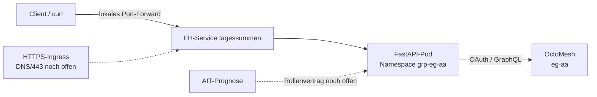

# VSYS WS 2026/27 – Projektübersicht Team AA

> **Stand:** 20. November 2026 · **FH Salzburg** · **Team:** AA / AA_Nexus  
> **OctoMesh-Mandant:** `eg-aa` · **Lokaler Cluster:** `vsct` / Kontext `kind-vsct` / Namespace `grp-uebung`  
> **FH-Cluster:** `cloud-lab` / Namespace `grp-eg-aa`  
> **Status:** FH-Referenzdienst betriebsfähig (HTTPS-Ingress offen); zusätzlich eigenes lokales AA_Nexus-FastAPI-Backend, GraphQL-Ankerermittlung, Zeitstempel-Datenqualitätsprüfung und Demo-Dashboard funktionsfähig. AIT/IMC, rollenbasierte Authentifizierung und M2-Abnahme offen.

**Ausführlicher technischer Bericht:** [VSYS_Team_AA_Technische_Dokumentation.md](VSYS_Team_AA_Technische_Dokumentation.md) – chronologischer Bericht mit Konfigurationen, ausgeführten und reproduzierbaren Befehlen, Testergebnissen, Ursachenanalyse und nächsten Schritten. Für GitHub sollen **beide Markdown-Dateien im gleichen Ordner** liegen. Einstieg: [README.md](README.md). Neue Erkenntnisse aus Schritt 20 sind in Abschnitt 7 und im technischen Bericht ab Abschnitt 14 enthalten.

## 1. Fachlicher Auftrag

Für die Energiegemeinschaft AA wurde der Mandant `eg-aa` verwendet. Die Gemeinschaft soll Stammdaten und Zählpunkte verwalten, historische 15-Minuten-Messwerte prüfen, Tagesprofile/Tagessummen für AIT bereitstellen, aus AIT-Prognosen eine Tagesposition pro Liefertag ableiten, diese mit IMC-Handelsplattformen austauschen und die Mitgliederabrechnung samt Dashboard, Security und Observability bereitstellen.

**Wichtige Arbeitsteilung:** Die Lehr-/OctoMesh-Plattform stellt Daten, Simulation und D+1-Verteilung bereit. Die EG-Gruppe verantwortet ihre eigenen Dienste, Qualitätskontrollen und Schnittstellen. INFRA betreibt das gemeinsame Kubernetes-Cluster und stellt die Infrastruktur für Deployments, DNS/Ingress und Observability zur Verfügung. AIT liefert Prognosen; IMC betreibt Handelsplattformen.

**Primärquellen:** [Team-Aufgaben EG](https://github.com/fhgerald/vsct-lab-studierende/blob/main/docs/08-team-energiegemeinschaft.md), [Tagessummen-Workshop](https://github.com/fhgerald/vsct-lab-studierende/blob/main/beispiele/tagessummen/README.md) und [Kubernetes-Aufbau](https://github.com/fhgerald/vsct-lab-studierende/blob/main/docs/12-kubernetes-uebersicht.md).

## 2. Implementierter technischer Datenfluss

- Der Beispielcode aus `beispiele/tagessummen` wurde zuerst lokal als Docker-Image gebaut und im kind-Cluster getestet.
- Anschließend wurde das bereits über GHCR abrufbare Referenzimage `ghcr.io/fhgerald/tagessummen:1.0` im FH-Cluster eingesetzt.
- Im FH-Cluster wurden `ConfigMap`, `Secret`, `Deployment`, `Service` und `Ingress` jeweils im Namespace `grp-eg-aa` eingerichtet.
- Der geschützte Datenendpunkt lieferte über `kubectl port-forward` echte Tagesregisterdaten für `eg-aa` mit `HTTP 200`. Ohne API-Key wurde `HTTP 401` ausgegeben.
- Die vorhandene API-Key-Prüfung ist **kein Ersatz** für eine rollenbasierte M2-Schnittstelle.

## 3. Nachgewiesener Status

| Bereich | Stand |
|---|---|
| Eigener OctoMesh-Mandant `eg-aa` | **Erledigt**; Datenabruf erfolgreich |
| Technischer Client / erneuertes Secret | **Eingerichtet**; sicher in Kubernetes Secrets verwendet |
| Lokales Kubernetes `vsct` | **Erledigt**; drei kind-Nodes, Namespace `grp-uebung` |
| Lokales FastAPI-Deployment | **Erledigt**; zwei bereite Pods, Service, ConfigMap, Secret |
| `healthz`, `readyz`, `/tagessummen` lokal | **Erledigt**; echte Daten und Negativtest |
| Quota, Selbstheilung, Skalierung, Worker-Ausfall | **Lokal getestet** |
| Fehlerhaftes Update / DST / Rollback | **Lokal getestet**; am 25.10.2026: 96 falsche statt 100 korrekter Intervalle |
| Readiness-Test mit falschem Secret | **Lokal getestet**; `READY 0/1`, HTTP 503; wieder bereinigt |
| FreeLens | **Eingerichtet**; lokale Workloads sichtbar |
| FH-Zugang über WSL2 und Cisco AnyConnect | **Funktioniert**; Mirrored Networking aktiviert |
| FH-Namespace `grp-eg-aa` | **Erreichbar**; Deployments dürfen angelegt werden |
| FH ConfigMap/Secret | **Eingerichtet**; 4 bzw. 3 Datenfelder |
| FH Deployment/Service | **Erledigt**; Pod bereit, Service über Port-Forward getestet |
| FH SecurityContext | **Ergänzt**; neues Rollout erfolgreich (`1/1 Running`) |
| FH Ingress | **Erstellt**; `eg-aa-tagessummen.machasing.com` |
| DNS und externe HTTPS-Erreichbarkeit | **Offen**; NXDOMAIN und Timeout auf Ingress-Adresse `172.30.0.200:443` |
| Rollenbasierte AIT-Schnittstelle und Prognosevertrag | **Offen** |
| AIT-/IMC-Integration, Abrechnung, Observability | **Offen** |
| Eigenes AA_Nexus-Backend (lokal) | **Läuft**; `127.0.0.1:8000`, FastAPI, OctoMesh-Client |
| GraphQL-Ermittlung der EnergyMeasurement-Anker | **Nachgewiesen**; 36 Anker auf 16 Zählpunkten |
| Datenqualitätsprüfung der Zeitstempel | **Nachgewiesen**; 36/36 vollständig für 23.10.2026 |
| Eigenes Dashboard | **Demo lokal**; `/dashboard` auf Port 8000, noch keine Live-Anbindung |
| RBAC | **Entwurf**; Rollenmodell vorgeschlagen, noch nicht als durchgesetzte AuthZ eingebunden |

## 4. Wichtige technische Namen und Pfade

| Objekt | Name / Pfad |
|---|---|
| Projektarbeitsverzeichnis Referenz in WSL | `~/projekte/vsct-lab-studierende/beispiele/tagessummen` |
| Eigenes Teamprojekt in WSL | `~/projekte/eg-aa` |
| Lokale kubeconfig | `~/.kube/config` (Context `kind-vsct`) |
| FH-kubeconfig | `~/.kube/cloud-lab` (Context `cloud-lab`, Rechte `600`) |
| Namespace lokal | `grp-uebung` |
| Namespace FH | `grp-eg-aa` |
| FastAPI-Deployment / Service | `tagessummen` |
| ConfigMap / Secret | `tagessummen` |
| Original Deployment | `k8s/20-deployment.yaml` |
| Gehärtetes FH-Deployment, temporär | `/tmp/tagessummen-fh.yaml` |
| Original Ingress-Vorlage | `cluster/ingress.yaml` |
| FH-Ingress-Entwurf, temporär | `/tmp/tagessummen-ingress-fh.yaml` |
| Lokaler Test-Tunnel | `localhost:8080` |
| FH-Test-Tunnel | `localhost:8081` |
| Geplanter HTTPS-Hostname | `eg-aa-tagessummen.machasing.com` |

Für eine spätere dauerhafte Reproduzierbarkeit sollten die nicht geheimen FH-Manifeste aus `/tmp` in ein versioniertes Team-Verzeichnis übernommen werden. Die geheimen Daten dürfen dabei nicht mitkopiert werden.

## 5. Nächste Schritte

1. **Externe Erreichbarkeit mit dem Infra-Team klären:** Der Ingress-Controller hat die Adresse `172.30.0.200` gemeldet, jedoch war der gewünschte DNS-Name weder in WSL noch unter Windows auflösbar und TCP/443 über FH-VPN nicht erreichbar. Die vom Infra-Team vorgesehene DNS-/Frontend-IP und Netzwerkfreigabe sind abzuklären.
2. **FH-Manifeste versionieren:** Gehartetes Deployment ohne lokale Fehlerübungs-Tolerations und Team-AA-Ingress als eigene, nicht geheime YAML-Dateien sichern.
3. **Funktion nach dem Security-Rollout erneut prüfen:** `/healthz`, `/readyz`, `/tagessummen` und Negativtest `401` noch einmal am aktuellen Pod durchführen.
4. **M2 mit AIT vereinbaren und umsetzen:** Felder, Datumsgrenzen, Register, Einheiten, Datenqualität, Tagesprofil, Fehlerfälle, Beispielantworten, Testclient und **rollenbasierte Autorisierung**. Der statische `X-API-Key` ist nur ein Lehrbeispiel.
5. **Eigenes EG-Backend sicher anbinden:** Dashboard aktuell nur Demo; benutzerbezogene Authentifizierung/RBAC und Zählpunktberechtigungen serverseitig einführen, bevor Live-Daten im Browser sichtbar werden.
6. **Fachliche EG-Funktionen erweitern:** Plausibilitätsprüfung der Energiewerte, Tagesbilanz, AIT-Prognose, Tagesposition und Handel mit IMC, Mitgliederabrechnung, Dashboard-Liveanbindung, Tests und dash0/OpenTelemetry.

## 6. Sicherheits- und Betriebsregeln

Zugangsdaten, private kubeconfig, Client-Secret, Token und API-Key dürfen weder in Markdown-Dateien noch in GitHub veröffentlicht werden. Die reale FH-kubeconfig verbleibt ausschließlich in WSL im geschützten Benutzerverzeichnis. Das lokale Secret und die FH-Kopie sind getrennte Kubernetes-Ressourcen und werden nicht automatisch synchronisiert.

Bei `kubectl` wird das Ziel stets explizit angegeben: **lokal** über `--context kind-vsct -n grp-uebung`; **FH** über `--kubeconfig="$HOME/.kube/cloud-lab" -n grp-eg-aa`. Destruktive Knotenausfall-/Quota-Übungen dürfen nur im lokalen kind-Cluster durchgeführt werden. Das FH-Namespace `grp-eg-aa` wird **nicht gelöscht oder neu angelegt**.

**Abschließende Einordnung:** Die technische Bereitstellung und ein vollständiger Datenabruf über den FH-Service wurden gezeigt. Der HTTPS-Ingress ist angelegt, aber noch nicht erfolgreich von außen aufgerufen worden. Die fachliche M2-Schnittstelle einschließlich Rollenprüfung und AIT-Abnahme steht aus.

## 7. Ergänzung vom 20.11.2026 – eigenes Teamprojekt / Schritt 20

**Kurzfassung:** In `~/projekte/eg-aa` entstand neben dem bereits im FH-Cluster laufenden **Referenzdienst** eine **eigene lokale** FastAPI-Anwendung. Ziel der längeren GraphQL-Untersuchung war, die Anker-IDs der Messreihen nicht fest im Code hinterlegen zu müssen: Zunächst wurde ein einzelner Zeitstempelstrom für Haushalt 012 geprüft; dann wurden über GraphQL-Schema-Introspektion die `EnergyMeasurement`-Anker und ihre Parent-Verbindungen ermittelt. Ergebnis: **36 Messdaten-Anker mit genau je einem Parent an 16 Zählpunkten** (12 Verbraucher, 4 PV-Erzeuger). Die gesamte Zeitstempelprüfung für den 23.10.2026 ergab **36 vollständige Reihen mit je 96 Zeitstempeln**, ohne Fehl-/Doppel-/ungültige Intervalle. Die Ergebnisse wurden über eigene geschützte lokale FastAPI-Endpunkte (`200` mit gültigem API-Key, `401` ohne) geprüft. Eine Demo-Weboberfläche wird bereits über `http://127.0.0.1:8000/dashboard` von FastAPI ausgeliefert, enthält aber noch keine Live-Daten.

**Wichtig:** Das neue Backend ist **noch nicht nachweislich auf dem FH-Cluster deployt**. Lokaler API-Key-Schutz ist kein RBAC; Benutzerlogin und zählpunktgenaue Freigaben fehlen. Qualitätsstatus beschreibt **Zeitstempel**, nicht Richtigkeit, Einheit oder Plausibilität der Energie-/Leistungswerte. Der alte FH-Ingress-Blocker besteht unabhängig von diesem lokalen Fortschritt.

**Dateien:** `backend/main.py`, `backend/octomesh_client.py`, `backend/data_quality.py`, `backend/eg_data_quality.py`, `backend/tagessummen_client.py`, Tests unter `backend/test_*.py`, `frontend/index.html`. Eine Datei `backend/permissions.py` wurde zum Schluss als nächster Arbeitsschritt vorgeschlagen; das Speichern oder Testen wurde **noch nicht bestätigt**.

**Weiterlesen:** [Abschnitt 14 bis 18 des technischen Berichts](VSYS_Team_AA_Technische_Dokumentation.md#14-phase-g--eigenes-lokales-eg-aa-backend-schritt-20) mit Architektur, GraphQL-Abfragen, Testausgaben, Befehlen und Fehlerdiagnosen.
