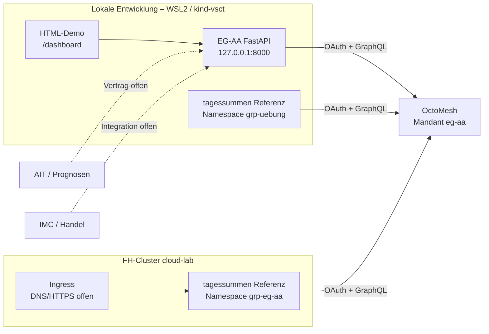

# EG-AA – Projektübersicht

**Lehrveranstaltung:** Verteilte Systeme und Cloud-Technologien · **FH Salzburg** · **Team:** AA  
**Mandant:** `eg-aa` · **Stand:** 21.11.2026 · **Repository:** [akhlas2/eg-aa](https://github.com/akhlas2/eg-aa)

## 1. Auftrag und Zusammenarbeit

Die Energiegemeinschaft (EG) verarbeitet historische 15-Minuten-Messdaten, prüft deren Qualität und stellt daraus verwertbare Tagesprofile bzw. Tagessummen bereit. Darauf aufbauend sind Tagespositionen, Prognoseintegration, Handel und Mitgliederabrechnung vorgesehen.

| Beteiligte | Verantwortung / Schnittstelle |
|---|---|
| **EG-AA** | Zählpunkte und Datenqualität, geschützte EG-APIs, Tagesposition, spätere Mitgliederabrechnung |
| **OctoMesh** | Mandant `eg-aa`, Messdaten, Stammdaten und GraphQL-Zugriff |
| **AIT** | Prognose-Dienst; Datenvertrag und technische Einbindung noch abzustimmen |
| **IMC** | Handelsplattform; Angebots-/Bedarfspositionen und Marktabwicklung später zu integrieren |
| **INFRA** | FH-Kubernetes, DNS/Ingress und gemeinsame Infrastruktur |

**Wichtig:** Der Tagessummen-Dienst aus den Lehrbeispielen ist eine **technische Referenz**, noch kein vereinbarter AIT/M2-Datenvertrag.

## 2. Architektur und Umgebungen

Es gibt **zwei getrennte Implementierungsstände**:

- **Lokal (kind):** Kubernetes-Kontext `kind-vsct`, Namespace `grp-uebung`, Referenzdienst `tagessummen` mit zuletzt **2/2** bereiten Pods. Eigenes Teambackend läuft bei Bedarf als separater lokaler Uvicorn-Prozess auf `127.0.0.1:8000`.
- **FH:** Cluster `cloud-lab`, Namespace `grp-eg-aa`. Der **Referenzdienst** wurde über Port-Forward erfolgreich abgefragt. Ingress erstellt, externe DNS-/HTTPS-Erreichbarkeit **nicht nachgewiesen**.
- **Nicht zu verwechseln:** OctoMesh-**Mandant** `eg-aa` ≠ Kubernetes-**Namespace** `grp-eg-aa` ≠ lokaler Namespace `grp-uebung`.

Das eigene EG-AA-Backend wurde **noch nicht nachweislich in den FH-Cluster deployt**.

## 3. Nachgewiesene Ergebnisse

| Bereich | Stand / Ergebnis |
|---|---|
| Lokales Kubernetes und Übungen | kind-Cluster, Deployment/Service, Quota, Skalierung, Selbstheilung, Fehler-Rollback und Readiness geprüft |
| FH-Kubernetes | VPN/WSL-Zugriff, Referenz-Deployment, Service, Secret/ConfigMap und PodSecurity-Härtung erprobt |
| FH-Ingress | Ressource angelegt; DNS/externes HTTPS noch offen |
| GraphQL-Ankerermittlung | **16 Zählpunkte** (12 Verbraucher, 4 PV-Erzeuger), **36 Messdaten-Anker**, jeweils mit Parent-Zuordnung |
| Datenqualität | Für **23.10.2026**: 36 Reihen × 96 Zeitstempel; fehlend **0**, doppelt **0**, ungültig **0** |
| Datenqualitäts-API | `/eg/datenqualitaet` und `/eg/datenqualitaet/gesamt` lokal erfolgreich getestet |
| Technische Authentifizierung | `auth.py`, API-Key als FastAPI-Dependency im Gesamt-Endpunkt; HTTP **200 mit**, **401 ohne** Key |
| Rollenregeln | `permissions.py`: `admin` und `mitglied`; nur lokale Prüflogik, **keine** echte Benutzeranmeldung |
| Automatisierte Tests | **20 Unit-Tests** erfolgreich (11 Datenqualität, 5 RBAC, 4 technische Authentifizierung) |
| Dashboard | HTML-Demo unter `/dashboard`, **noch ohne Live-Daten** |
| GitHub | Initialer Commit `d5d35cf` auf `main` gepusht; neuere Änderungen noch separat zu committen |

**Qualitätsgrenze:** Die Ergebnisse bestätigen die **Zeitstempelstruktur**, nicht die Korrektheit von Energie-/Leistungswerten, Einheiten oder Abrechnungsdaten.

## 4. GraphQL: Was wurde gesucht und warum?

Ziel war eine **dynamische** Ermittlung der Messdaten-Anker, damit ihre IDs nicht einzeln im Python-Code stehen müssen.

| Frage | Vorgehen / Erkenntnis |
|---|---|
| Wie heißen GraphQL-Felder und Rückgabetypen? | Schema-Introspection mit `__type(...)` |
| Wie finde ich alle Messdaten-Anker? | `runtime.basicEnergyEnergyMeasurement(first: 100)` → `totalCount: 36`, keine Folgeseite |
| Zu welchem Zählpunkt gehört ein Anker? | `parent(ckTypeIds: ["EnergyCommunity/Consumer", "EnergyCommunity/Producer"])`; passende Union-Fragmente für Erzeuger/Verbraucher |
| Wie prüfe ich ein Register? | Zeitstempel aus dem Stream-Archiv pro `rtId` und lokalem Kalendertag (UTC-Grenzen, Zeitzone `Europe/Vienna`) laden |
| Wie bewerte ich Vollständigkeit? | Erwartete Intervalle **92/96/100** je nach Sommer-/Winterzeitumstellung; fehlende/doppelte/ungültige Zeitstempel getrennt zählen |

Die **tatsächlich funktionierenden GraphQL-Abfragen und ihre Ergebnisse** stehen in der [technischen Dokumentation, Kapitel 12](VSYS_Team_AA_Technische_Dokumentation.md#12-phase-g-graphql-recherche-und-messdaten-zuordnung). Hier werden sie nicht nochmals vollständig wiederholt.

## 5. Entwicklungsstand und nächste Aufgaben

**Zuletzt nachgewiesen:** Der Gesamt-Endpunkt verwendet `Depends(authentifiziere_service)`. Ohne Schlüssel liefert er **401**, mit gültigem Schlüssel **200** und die Prüfung der **36** Anker. Die neuen RBAC- und Authentifizierungsregeln sind mit insgesamt **20 erfolgreichen Unit-Tests** abgesichert.

**Prioritäten:**

1. **Sicherheitsarchitektur:** Individuelle Authentifizierung festlegen; Benutzeridentität verifizieren; RBAC und zählpunktgenaue Filter **serverseitig** in echte API-Endpunkte integrieren. Der Service-Key reicht dafür nicht aus.
2. **Fachliche Datenqualität:** Energiewerte und Einheiten prüfen, fehlende/nachgemeldete Datensätze behandeln und M2-Datenvertrag mit AIT vereinbaren.
3. **Dashboard:** Erst nach Umsetzung einer angemessenen Anmeldung Live-Daten statt Demo-Werten anzeigen.
4. **FH-Betrieb:** Nicht geheime Deployment-/Ingress-Manifeste versionieren, DNS/HTTPS mit INFRA klären, Referenzdienst nach Security-Rollout erneut prüfen und das eigene Backend kontrolliert deployen.
5. **Fachintegration:** AIT-Prognosen, Tagespositionen, IMC-Handel, Mitgliederabrechnung, Logs/Traces/Metriken.
6. **Versionsstand:** Neue Python-Dateien und aktualisierte Dokumentation prüfen, committen und nach GitHub pushen.

## 6. Arbeitsverzeichnisse und Sicherheit

| Gegenstand | Pfad / Wert |
|---|---|
| Eigenes EG-AA-Projekt | `~/projekte/eg-aa` |
| Lehr-/Referenzprojekt | `~/projekte/vsct-lab-studierende/beispiele/tagessummen` |
| Python-Umgebung | `~/projekte/eg-aa/.venv` |
| Lokaler kind-Kontext / Namespace | `kind-vsct` / `grp-uebung` |
| FH-kubeconfig / Namespace | `~/.kube/cloud-lab` / `grp-eg-aa` |
| Lokale eigene API | `http://127.0.0.1:8000` |
| Demo-Oberfläche | `http://127.0.0.1:8000/dashboard` |
| Repository | `https://github.com/akhlas2/eg-aa.git` |

**Sicherheitsregeln:** Zugangsdaten nur über geschützte Konfiguration/Umgebungsvariablen verwenden; keine Secrets oder privaten kubeconfigs committen. Kubernetes-Befehle stets mit eindeutiger Cluster-/Namespace-Angabe ausführen. Destruktive Übungen ausschließlich im lokalen kind-Cluster.

## 7. Weiterführende Dokumentation

- [Technische Dokumentation](VSYS_Team_AA_Technische_Dokumentation.md): Phasen A–I, Befehle, GraphQL, Tests und Wiederanlauf (insbesondere **Kapitel 12, 15 und 16**).
- [GitHub-Anleitung](GITHUB_UPLOAD.md): sichere Prüfung von Änderungen und Aktualisierung des bestehenden Repositories.
- [Tagessummen-Referenzprojekt](https://github.com/fhgerald/vsct-lab-studierende/tree/main/beispiele/tagessummen)
- [Aufgaben der Energiegemeinschaft](https://github.com/fhgerald/vsct-lab-studierende/blob/main/docs/08-team-energiegemeinschaft.md)
