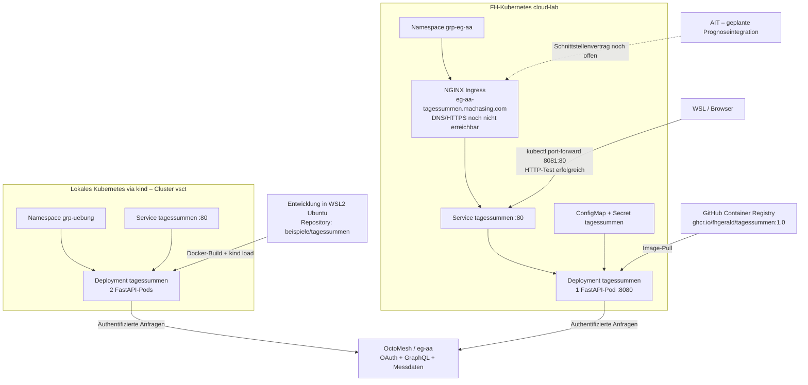
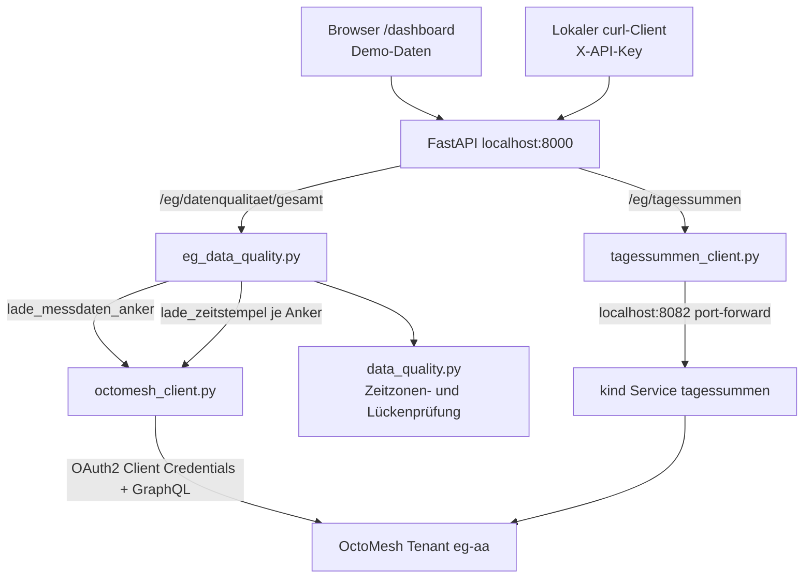

# Technische Projektdokumentation – Energiegemeinschaft AA

**Lehrveranstaltung:** Verteilte Systeme und Cloud-Technologien, FH Salzburg, WS 2026/27  
**Team:** AA / AA_Nexus · **Fachlicher OctoMesh-Mandant:** `eg-aa`  
**Dokumentationsstand:** 20. November 2026 (FH-Ingress-Stand plus eigenes lokales AA_Nexus-Backend, GraphQL-Recherche und Demo-Dashboard)  
**Dokumenttyp:** Technischer Implementierungs-, Test- und Betriebsbericht  
**Nachweisstatus:** Dokumentierte Terminalausgaben und Funktionstests; **keine formale Abnahme** durch Lehrende oder das Infrastrukturteam.

> **Sicherheit:** Diese Dokumentation enthält ausschließlich Ressourcennamen, Konfigurationen ohne Geheimnisse, Beispielbefehle und nicht geheime Diagnoseausgaben. Zugangsdaten, private Schlüssel, Token, der tatsächliche API-Key und vollständige kubeconfig-Dateien dürfen **nicht** in Git eingecheckt werden. Sämtliche in dieser Dokumentation verwendeten Platzhalter sind vor einer Wiederholung mit eigenen, autorisiert erhaltenen Werten zu belegen.

## Inhaltsverzeichnis

1. [Aufgabenstellung und Quellen](#1-aufgabenstellung-und-quellen)
2. [Technische Gesamtübersicht](#2-technische-gesamtübersicht)
3. [Verzeichnisstruktur und Ressourceninventar](#3-verzeichnisstruktur-und-ressourceninventar)
4. [Phase A – Lokale kind-Umgebung](#4-phase-a--lokale-kind-umgebung)
5. [Phase B – Lokale Kubernetes-Übungen und Nachweise](#5-phase-b--lokale-kubernetes-übungen-und-nachweise)
6. [Phase C – FreeLens und Bereinigung alter Kontexte](#6-phase-c--freelens-und-bereinigung-alter-kontexte)
7. [Phase D – FH-Kubernetes-Onboarding und WSL-/VPN-Netzwerk](#7-phase-d--fh-kubernetes-onboarding-und-wsl-vpn-netzwerk)
8. [Phase E – FH-Deployment und Funktionsnachweis](#8-phase-e--fh-deployment-und-funktionsnachweis)
9. [Phase F – Sicherheitshärtung und Ingress](#9-phase-f--sicherheitshärtung-und-ingress)
10. [Fehleranalyse: DNS-/Ingress-Erreichbarkeit](#10-fehleranalyse-dns-ingress-erreichbarkeit)
11. [Gesamtnachweise, offener Stand und nächste Schritte](#11-gesamtnachweise-offener-stand-und-nächste-schritte)
12. [Reproduzierbarkeit, Betrieb und sichere Bereinigung](#12-reproduzierbarkeit-betrieb-und-sichere-bereinigung)
13. [Quellen und Abgrenzungen](#13-quellen-und-abgrenzungen)
14. [Phase G – Eigenes lokales EG-AA-Backend (Schritt 20)](#14-phase-g--eigenes-lokales-eg-aa-backend-schritt-20)
15. [GraphQL-Recherche: Welche Abfragen, wofür und was gefunden?](#15-graphql-recherche-welche-abfragen-wofür-und-was-gefunden)
16. [Datenqualität und End-to-End-Tests](#16-datenqualität-und-end-to-end-tests)
17. [Lokaler Betrieb: vollständige Befehle](#17-lokaler-betrieb-vollständige-befehle)
18. [Frontend, Sicherheit, Fehlerdiagnose und offene Arbeiten](#18-frontend-sicherheit-fehlerdiagnose-und-offene-arbeiten)

---

## 1. Aufgabenstellung und Quellen

### 1.1 Ausgangspunkt

Als Grundlage wurde das öffentliche Lehr-Repository **[`fhgerald/vsct-lab-studierende`](https://github.com/fhgerald/vsct-lab-studierende)** herangezogen. Die praktische Ausgangsaufgabe befindet sich unter [`beispiele/tagessummen/README.md`](https://github.com/fhgerald/vsct-lab-studierende/blob/main/beispiele/tagessummen/README.md) und beschreibt den Workshop vom **11.11.2026**. Darin wird ein FastAPI-Referenzdienst bereitgestellt, der historische **15-Minuten-Werte** einer Energiegemeinschaft über die **OctoMesh-GraphQL-API** abfragt, nach Kalendertag/OBIS-Register aggregiert und über `GET /tagessummen` als JSON ausgibt.

Die Übung verlangt zunächst ein lokales Kubernetes-Cluster mit **kind**, anschließend absichtlich hervorgerufene Fehler und deren Beobachtung (Quotas, Selbstheilung, Skalierung, Knotenausfall, fehlerhaftes Update/Rollback und Readiness). Nach erfolgreicher lokaler Durchführung kann der Dienst in den eigenen Namespace des **FH-Lab-Clusters** übertragen werden. Der Beispielcode ist **ausdrücklich kein vereinbarter M2-Schnittstellenvertrag**.

Die fachliche Verpflichtung der EG-Gruppe wird unter [`docs/08-team-energiegemeinschaft.md`](https://github.com/fhgerald/vsct-lab-studierende/blob/main/docs/08-team-energiegemeinschaft.md) definiert: Ein eigener EG-Mandant, Datenprüfung, eine **rollengeschützte Tagessummen-/Tagesprofil-Schnittstelle für AIT**, später Tagesbilanz, Prognose/Handel und Mitgliederabrechnung. Die Betriebstrennung des FH-Clusters wird unter [`docs/12-kubernetes-uebersicht.md`](https://github.com/fhgerald/vsct-lab-studierende/blob/main/docs/12-kubernetes-uebersicht.md) erklärt.

### 1.2 Abgrenzung der Durchführung

| Gegenstand | Vorgabe/Aufgabe | Nachgewiesene Umsetzung |
|---|---|---|
| Lokaler Dienst | FastAPI mit OctoMesh und Health-Endpoints | Erfolgreich auf `kind-vsct` getestet |
| Pflicht-Negativtest | Fehlender API-Key liefert `401` | Lokal und auf FH nachgewiesen |
| Kubernetes-Quota | Pod ohne Ressourcenlimits wird abgewiesen | Lokal nachgewiesen |
| Kubernetes-Resilienz | Selbstheilung, Skalierung, Rollback, Ausfall | Lokal durchgeführt und ausgewertet |
| FH-Betrieb | Eigenes Deployment, Service, ConfigMap, Secret | Im Namespace `grp-eg-aa` eingerichtet und getestet |
| FH-Sicherheit | PodSecurity-Anforderungen | Deployment aktualisiert, neues Rollout erfolgreich |
| Öffentlicher HTTPS-Zugang | Hostname über NGINX-Ingress | Ingress angelegt; **DNS/Netzwerkerreichbarkeit offen** |
| M2 für AIT | Rollenprüfung und abgestimmter Datenvertrag | **Noch nicht umgesetzt oder abgenommen** |

---

## 2. Technische Gesamtübersicht



**Wichtige Unterscheidungen:** `eg-aa` bezeichnet den **fachlichen OctoMesh-Mandanten**. `grp-uebung` ist der **lokale Kubernetes-Namespace**. `grp-eg-aa` ist der **FH-Kubernetes-Namespace**. Diese Namen dürfen nicht gleichgesetzt werden. Der lokale Cluster wird **nicht als ganzer Cluster „gepusht“**: Das Container-Image wird bereitgestellt und die Kubernetes-Ressourcen werden im Zielcluster separat angelegt.

Die Anwendung nutzt `OCTO_CLIENT_ID` und `OCTO_CLIENT_SECRET` für die **ausgehende** Authentifizierung bei OctoMesh. Ein separat erzeugter `API_KEY` schützt die **eingehende** `/tagessummen`-Schnittstelle vor unberechtigten Anfragen. Dieser statische Key ist nur ein Referenzschutz, keine rollenbasierte AIT-Autorisierung.

---

## 3. Verzeichnisstruktur und Ressourceninventar

### 3.1 Arbeitsverzeichnis

In der ausgeführten WSL2-Ubuntu-Umgebung wurde das Projekt unter folgendem Pfad verwendet:

```text
/home/moham/projekte/vsct-lab-studierende/beispiele/tagessummen/
├── README.md
├── app/
│   ├── Dockerfile
│   ├── main.py
│   └── requirements.txt
├── kind/
│   └── cluster.yaml
├── k8s/
│   ├── 00-namespace.yaml
│   ├── 10-configmap.yaml
│   ├── 20-deployment.yaml
│   ├── 30-service.yaml
│   ├── uebung-aufrufer.yaml
│   └── uebung-ohne-limits.yaml
└── cluster/
    └── ingress.yaml
```

Die Originaldateien stammen aus dem Lehr-Repository. Im lokalen Arbeitsverzeichnis wurde **`k8s/10-configmap.yaml` von `eg-lehrende` auf `eg-aa` geändert**. Die FH-spezifischen Deployment-/Ingress-Varianten wurden vorläufig im Verzeichnis `/tmp` erstellt; sie sind **nicht automatisch im Git-Repository versioniert** und sollten für reproduzierbare weitere Arbeit später unter einem geeigneten nicht geheimen Verzeichnis eingecheckt werden.

### 3.2 Tatsächlich verwendete Namen und Pfade

| Zweck | Wert | Speicherort/Bedeutung |
|---|---|---|
| lokaler kind-Cluster | `vsct` | Docker-Container `vsct-control-plane`, `vsct-worker`, `vsct-worker2` |
| lokaler Kubernetes-Kontext | `kind-vsct` | `~/.kube/config` |
| lokaler Namespace | `grp-uebung` | kind-Cluster `vsct` |
| lokale Quota | `kontingent` | `grp-uebung` |
| FH-Cluster/Kontext | `cloud-lab` | persönliche FH-kubeconfig |
| persönliche FH-kubeconfig | `~/.kube/cloud-lab` | WSL; Berechtigung `600`; **nie versionieren** |
| FH-Namespace | `grp-eg-aa` | bereits vom Infra-Team angelegt |
| OctoMesh-Tenant | `eg-aa` | über `OCTO_TENANT` in ConfigMap gesetzt |
| Deployment | `tagessummen` | lokal und FH, jeweils in unterschiedlichen Namespaces |
| Service | `tagessummen` | TCP-Port `80` → Container-Port `8080` |
| ConfigMap | `tagessummen` | vier nicht geheime Variablen |
| Kubernetes-Secret | `tagessummen` | `OCTO_CLIENT_ID`, `OCTO_CLIENT_SECRET`, `API_KEY` |
| Image, Version 1.0 | `ghcr.io/fhgerald/tagessummen:1.0` | lokal gebaut/geladen; zusätzlich als öffentlich abrufbares GHCR-Image geprüft |
| Übungs-Fehlerimage | `ghcr.io/fhgerald/tagessummen:1.1-fehler` | lokal für Rollback-Test verwendet |
| FH-Deployment-Entwurf | `/tmp/tagessummen-fh.yaml` | ohne Übungs-Tolerations, mit PodSecurity-Einstellungen |
| FH-Ingress-Entwurf | `/tmp/tagessummen-ingress-fh.yaml` | Host auf `eg-aa-tagessummen.machasing.com` gesetzt |
| FH-Ingress-Name | `tagessummen` | NGINX Ingress im Namespace `grp-eg-aa` |
| FH-Ingress-Adresse | `172.30.0.200` | vom Controller gemeldet; **extern nicht erreichbar nachgewiesen** |
| Port-Forward lokal | `localhost:8080` | lokale kind-Testanfragen |
| Port-Forward FH | `localhost:8081` | FH-Testanfragen |

### 3.3 API und Konfiguration

Der Referenzdienst stellt bereit:

| Route | Verhalten |
|---|---|
| `GET /healthz` | Liveness: Prozess antwortet, Pod-Name und Version |
| `GET /readyz` | Readiness: benötigte Konfiguration vorhanden und OctoMesh-OAuth-Token abrufbar |
| `GET /tagessummen?von=YYYY-MM-DD&bis=YYYY-MM-DD` | Inklusiver Zeitraum (maximal 31 Tage), Tagessummen nach Register, kWh und Anzahl Werte; benötigt `X-API-Key` |

Verwendete nicht geheime Konfiguration:

```yaml
apiVersion: v1
kind: ConfigMap
metadata:
  name: tagessummen
data:
  OCTO_TENANT: eg-aa
  OCTO_TOKEN_URL: https://connect.machasing.com/connect/token
  OCTO_ASSETS_URL: https://assets.machasing.com
  ZEITZONE: Europe/Vienna
```

Die GraphQL-Abfrage des Beispielcodes verwendet das 15-Minuten-Archiv `ec0000000000000000000a01`, gruppiert nach `ObisCode` und aggregiert `Amount.Value` über `SUM` und `COUNT`. Die Tagesgrenzen werden in `Europe/Vienna` gebildet und anschließend in UTC für die GraphQL-Abfrage übergeben. Das ist wegen der Sommer-/Winterzeitumstellung relevant.

---

## 4. Phase A – Lokale kind-Umgebung

**Aufgabe:** Eine isolierte Kubernetes-Testumgebung für das Referenzbeispiel war einzurichten, ohne den FH-Cluster zu verändern.

### 4.1 Vorbereitungen

Die lokale Umgebung bestand aus **Windows 11**, **WSL2 Ubuntu**, **Docker Desktop**, **kubectl** und **kind**. Das Projektverzeichnis wurde in WSL aufgerufen:

```bash
cd ~/projekte/vsct-lab-studierende/beispiele/tagessummen
ls -la
```

Ausgangspunkt war die im Lehr-Repository enthaltene Definition `kind/cluster.yaml` mit **einem Control-Plane-Knoten und zwei Workern**.

```bash
kind create cluster --name vsct --config kind/cluster.yaml
kind get clusters
kubectl config get-contexts
kubectl --context kind-vsct get nodes
```

Als nachgewiesener Endzustand waren die drei Docker-Container `vsct-control-plane`, `vsct-worker`, `vsct-worker2` vorhanden; die Knoten waren in den erfolgreichen Kubernetes-Prüfungen `Ready`.

> **Historischer Hinweis:** Der frühere Lerncluster `k8s-lernen` war zusätzlich vorhanden und wurde im Rahmen der Bereinigung **gezielt gelöscht** (`kind delete cluster --name k8s-lernen`). Der aktuelle lokale kind-Bestand enthielt anschließend nur `vsct`. Dieser Befehl darf **nicht** als allgemeiner Vorbereitungsschritt für andere Geräte blind übernommen werden.

### 4.2 Image-Build und lokales Laden

Das Beispiel wurde lokal als Container-Image gebaut. Für die Übung wurde zusätzlich eine absichtlich fehlerhafte Variante erstellt:

```bash
docker build -t ghcr.io/fhgerald/tagessummen:1.0 app
docker build -t ghcr.io/fhgerald/tagessummen:1.1-fehler \
  --build-arg APP_VERSION=1.1-fehler app
kind load docker-image --name vsct \
  ghcr.io/fhgerald/tagessummen:1.0 \
  ghcr.io/fhgerald/tagessummen:1.1-fehler
```

Die Namen `ghcr.io/fhgerald/...` wurden im Lehrbeispiel verwendet. **Das lokale `docker build` und `kind load` veröffentlichen keine Images in einer Registry.** Die Images wurden zunächst nur auf dem eigenen Rechner gebaut bzw. in die kind-Knoten geladen.

Das Dockerfile verwendet `python:3.12-slim`, installiert `tzdata` und Python-Abhängigkeiten, startet Uvicorn auf Port `8080` und setzt `USER 10001` (Nicht-Root-Betrieb).

### 4.3 Namespace und ResourceQuota

Das lokale Namespace-Manifest wurde **nur auf kind** angewendet:

```bash
kubectl --context kind-vsct apply -f k8s/00-namespace.yaml
kubectl config set-context kind-vsct --namespace=grp-uebung
kubectl --context kind-vsct -n grp-uebung get resourcequota
```

Die Quota `kontingent` entsprach dem Übungsbudget:

| Ressource | Limit |
|---|---:|
| CPU-Limits | `4` CPU |
| Arbeitsspeicher-Limits | `8Gi` |
| Persistenter Speicher (Requests) | `20Gi` |
| Pods | `30` |
| LoadBalancer-Services | `1` |

**Abgrenzung:** `k8s/00-namespace.yaml` enthält ausdrücklich den **lokalen** Namespace `grp-uebung`; es wurde **nicht** auf den FH-Cluster angewendet. Der FH-Namespace `grp-eg-aa` war bereits vom Infra-Team vorbereitet.

### 4.4 OctoMesh-Tenant und Secret

In `k8s/10-configmap.yaml` wurde der ursprüngliche Lehr-Tenant `eg-lehrende` auf den Team-Tenant `eg-aa` geändert. Ein OctoMesh-Client mit der Leseberechtigung `StreamDataReader` wurde verwendet. Nach einer früheren versehentlichen Offenlegung wurde das betroffene Client-Secret durch die Betreuung **erneuert**; die weitere Testumgebung nutzte das erneuerte Secret.

Die vertraulichen Werte wurden als Kubernetes-Secret namens `tagessummen` gespeichert; eine Secret-Datei wurde **nicht** im Repository abgelegt. Das Secret enthielt die Schlüssel `OCTO_CLIENT_ID`, `OCTO_CLIENT_SECRET` und einen für die eigene API zufällig erzeugten `API_KEY`.

**Sicheres Beispiel für eine Neueinrichtung** (die vertraulichen Werte werden interaktiv und ohne Echo erfasst; die Anmeldedaten müssen aus einem autorisierten Kanal stammen):

```bash
read -r -p 'OctoMesh Client-ID: ' OCTO_CLIENT_ID
read -r -s -p 'OctoMesh Client-Secret: ' OCTO_CLIENT_SECRET; printf '\n'
read -r -s -p 'Eigener API-Key (leer = zufällig erzeugen): ' API_KEY; printf '\n'
API_KEY="${API_KEY:-$(openssl rand -hex 32)}"

kubectl --context kind-vsct -n grp-uebung create secret generic tagessummen \
  --from-literal=OCTO_CLIENT_ID="$OCTO_CLIENT_ID" \
  --from-literal=OCTO_CLIENT_SECRET="$OCTO_CLIENT_SECRET" \
  --from-literal=API_KEY="$API_KEY"
unset OCTO_CLIENT_ID OCTO_CLIENT_SECRET API_KEY
```

> Bei produktiver Wiederholung sind zentral verwaltete Secret-Mechanismen und organisatorische Anforderungen des Infra-Teams vorzuziehen. Die gezeigte Methode ist für das dokumentierte Lehrlabor geeignet, sofern Shell-Verlauf, Prozessumgebung, Berechtigungen und Terminalzugriff berücksichtigt werden. Geheime Werte niemals in Befehlsausgaben oder Screenshots anzeigen.

### 4.5 Deployment und Service lokal

```bash
kubectl --context kind-vsct -n grp-uebung apply -f k8s/10-configmap.yaml
kubectl --context kind-vsct -n grp-uebung apply -f k8s/20-deployment.yaml
kubectl --context kind-vsct -n grp-uebung apply -f k8s/30-service.yaml
kubectl --context kind-vsct -n grp-uebung get pods -o wide
kubectl --context kind-vsct -n grp-uebung port-forward svc/tagessummen 8080:80
```

Die Portweiterleitung wurde während der Browser-/curl-Tests geöffnet gehalten. Der lokale `/healthz`-Aufruf antwortete erfolgreich. `/readyz` bestätigte die erfolgreiche Tokenbeschaffung von OctoMesh. Anschließend wurden reale Tagessummen für `eg-aa` abgefragt.

**Lokaler Negativtest:** Eine Anfrage ohne `X-API-Key` lieferte `HTTP 401 Unauthorized`. Die Verbindung war damit testweise gegen anonyme Abfragen des eigentlichen Datenendpunkts geschützt, jedoch **nicht rollenbasiert**.

---

## 5. Phase B – Lokale Kubernetes-Übungen und Nachweise

**Aufgabe:** Die in `beispiele/tagessummen/README.md` vorgegebenen Verhaltensweisen des verteilten Dienstes wurden beobachtet. Alle destruktiven Fehlersimulationen wurden **ausschließlich lokal** ausgeführt.

### 5.1 Reale Tagessummen und Datenverarbeitung

Die API wurde mit dem Header `X-API-Key` aufgerufen; der Schlüssel wurde dabei aus dem lokalen Kubernetes-Secret in eine temporäre Shell-Variable eingelesen (nicht ausgegeben). Ein sicherer Beispielaufruf:

```bash
read -r API_KEY < <(
  kubectl --context kind-vsct -n grp-uebung get secret tagessummen \
    -o jsonpath='{.data.API_KEY}' | base64 -d
)
curl -sS -i -H "X-API-Key: $API_KEY" \
  'http://127.0.0.1:8080/tagessummen?von=2026-10-23&bis=2026-10-24'
unset API_KEY
```

Für den **23.10.2026** wurde erfolgreich Folgendes ermittelt (Mandant `eg-aa`; Europe/Vienna; **96 Viertelstunden**):

| OBIS-Register | Summe | Anzahl Messwerte |
|---|---:|---:|
| `1-1:1.9.0 G.01` | 1438,391 kWh | 1152 |
| `1-1:2.9.0 G.01` | 967,753 kWh | 384 |
| `1-1:2.9.0 G.01T` | 967,673 kWh | 384 |
| `1-1:2.9.0 G.03` | 819,510 kWh | 1152 |
| `1-1:2.9.0 P.01T` | 148,163 kWh | 384 |

Die Zählungen sind **Register-Aggregationen über mehrere Zählpunkte**; `1152` bedeutet beispielsweise 12 × 96 Werte, nicht 1152 Viertelstunden eines einzelnen Tages.

### 5.2 Selbstheilung des Deployments

**Aufgabe:** Ein laufender Pod wurde entfernt, während ein Deployment dessen Sollzustand vorgab.

**Durchführung (lokal):**

```bash
kubectl --context kind-vsct -n grp-uebung get pods
kubectl --context kind-vsct -n grp-uebung delete pod <konkreter-tagessummen-podname>
kubectl --context kind-vsct -n grp-uebung get pods -w
```

**Beobachtung:** Kubernetes erzeugte automatisch einen Ersatz-Pod, der nach ungefähr **12 Sekunden** wieder bereit war. Die Demonstration zeigte die Selbstheilung über den Deployment-/ReplicaSet-Controller. Der konkrete Pod-Name wurde dynamisch erzeugt und ist kein stabiler Konfigurationswert.

### 5.3 Horizontale Skalierung und Service-Verteilung

**Aufgabe:** Die Anwendung war von einer auf **zwei Repliken** zu skalieren; anschließend sollte die Verteilung der Requests zwischen den Pods nachgewiesen werden.

```bash
kubectl --context kind-vsct -n grp-uebung scale deployment/tagessummen --replicas=2
kubectl --context kind-vsct -n grp-uebung get pods -o wide
kubectl --context kind-vsct -n grp-uebung apply -f k8s/uebung-aufrufer.yaml
kubectl --context kind-vsct -n grp-uebung logs -f pod/aufrufer
```

**Beobachtung:** Beide FastAPI-Pods waren bereit; anfänglich wurden sie auf unterschiedlichen Worker-Knoten ausgeführt. Die Logs des Test-Pods `aufrufer` enthielten wiederholt `HTTP/1.1 200 OK` mit wechselndem Header `x-pod`. Dadurch konnte die Weiterleitung über den Kubernetes-Service auf beide Repliken nachgewiesen werden.

### 5.4 Fehlerhaftes Update und Rollback – Zeitzonenfehler

**Aufgabe:** Ein formal gesundes Deployment sollte trotzdem einen **fachlichen Berechnungsfehler** aufweisen. Dafür wurde die im Lehrbeispiel absichtlich fehlerhafte Version `1.1-fehler` verwendet. Sie bildet Tagesgrenzen in UTC statt in `Europe/Vienna`.

```bash
kubectl --context kind-vsct -n grp-uebung set image \
  deployment/tagessummen tagessummen=ghcr.io/fhgerald/tagessummen:1.1-fehler
kubectl --context kind-vsct -n grp-uebung rollout status deployment/tagessummen
# Anschließend funktionalen Test für 2026-10-25 ausführen
kubectl --context kind-vsct -n grp-uebung rollout undo deployment/tagessummen
kubectl --context kind-vsct -n grp-uebung rollout status deployment/tagessummen
```

**Nachgewiesene Abweichung am 25.10.2026 (Ende der Sommerzeit in Wien):**

| Ausführung | Viertelstunden | `1-1:1.9.0 G.01` | Anzahl G.01-Werte |
|---|---:|---:|---:|
| Version `1.1-fehler` | **96** | **1438,391 kWh** | 1152 |
| Version `1.0` nach Rollback | **100** | **1453,614 kWh** | 1200 |

**Erkenntnis:** Beide Versionen konnten funktionsfähige Health-/Readiness-Probes haben. Trotzdem war die Datumsberechnung der Fehler-Version fachlich falsch. **Technische Readiness ersetzt keine fachlichen Tests**, insbesondere nicht an Zeitumstellungstagen. Durch `rollout undo` wurde der korrekte Zustand wiederhergestellt.

### 5.5 Lokaler Worker-Ausfall

**Aufgabe:** Das Verhalten des Dienstes bei Ausfall eines Worker-Knotens wurde untersucht. Der kontinuierliche Test-Pod `aufrufer` blieb auf einem überlebenden Worker.

```bash
kubectl --context kind-vsct -n grp-uebung get pods -o wide
docker stop vsct-worker
kubectl --context kind-vsct get nodes
kubectl --context kind-vsct -n grp-uebung get pods -o wide
kubectl --context kind-vsct -n grp-uebung logs pod/aufrufer
# Wiederherstellung:
docker start vsct-worker
kubectl --context kind-vsct get nodes
```

**Beobachtung:** Der gestoppte Node wurde `NotReady`; ein Ersatz-Pod lief auf dem verbleibenden Worker. Die Requests lieferten überwiegend `200 OK`; vereinzelte leere Logzeilen deuteten auf mögliche kurzfristige Unterbrechungen hin, wurden jedoch nicht als exakt gemessene Ausfallzeit ausgewiesen. Nach `docker start` waren wieder alle drei Nodes `Ready`. Die verbleibenden zwei Tagessummen-Pods befanden sich anschließend beide auf `vsct-worker2` – eine zulässige Platzierung, nicht zwingend ein Problem.

**Sicherheitsgrenze:** Node-Stopp und vergleichbare Ausfallversuche dürfen **nicht** am gemeinsam betriebenen FH-Cluster durchgeführt werden.

### 5.6 ResourceQuota – Pod ohne Limits

**Aufgabe:** Es war zu prüfen, wie der Namespace auf einen Pod ohne vorgeschriebene Ressourcenlimits reagiert.

```bash
kubectl --context kind-vsct -n grp-uebung apply -f k8s/uebung-ohne-limits.yaml
kubectl --context kind-vsct -n grp-uebung describe resourcequota kontingent
```

**Ergebnis:** Das Erstellen des Pods `ohne-limits` wurde abgewiesen. Die Fehlermeldung enthielt `pods "ohne-limits" is forbidden: failed quota` sowie fehlende Angaben für `limits.cpu` und `limits.memory`. Im Verlauf wurden ungefähr `550m/4` CPU-Limits, `288Mi/8Gi` RAM-Limits und `3/30` Pods im lokalen Namespace angezeigt. Das Quota-Verhalten wurde damit nachvollziehbar nachgewiesen.

### 5.7 Readiness bei ungültigen Zugangsdaten

**Aufgabe:** Ein Dienst mit ungültigen OctoMesh-Zugangsdaten sollte die Readiness-Prüfung nicht bestehen.

Dafür wurde **lokal** ein separates Secret `tagessummen-test` mit bewusst falschen Zugangsdaten und ein separater Test-Pod angelegt. Das reguläre Secret `tagessummen` und die beiden funktionsfähigen Service-Pods blieben unangetastet. Der Test-Pod befand sich im Zustand `Running`, jedoch `READY 0/1`; über `kubectl describe` wurde die Readiness-Fehlermeldung **HTTP 503** beobachtet. Die Test-Ressourcen wurden anschließend wieder gelöscht.

> Der exakte temporäre Pod-YAML-Inhalt liegt nicht als versionierte Datei vor. Aus diesem Grund wird keine nachträglich erfundene vollständige Pod-Definition als tatsächlich ausgeführter Befehl ausgegeben. Reproduzierbar ist das Vorgehen durch einen separaten Test-Pod mit `envFrom.secretRef.name: tagessummen-test` und den gleichen Probes wie beim regulären Deployment.

### 5.8 Aufräumen und lokaler Endzustand

Nach den Übungen wurden der Test-Pod `aufrufer`, der Readiness-Test-Pod und das künstlich falsche Secret `tagessummen-test` wieder entfernt. Der reguläre Dienst und sein echtes Secret blieben erhalten. Der lokale Endzustand war:

- kind-Cluster `vsct` mit drei `Ready`-Nodes.
- Namespace `grp-uebung` mit Quota `kontingent`.
- Deployment `tagessummen`, **zwei** bereite FastAPI-Pods (`1/1 Running`).
- Service `tagessummen`, ConfigMap `tagessummen` und Secret `tagessummen` mit **3** Datenfeldern.
- Image-Version nach Rollback wieder `1.0`.

```bash
kubectl --context kind-vsct -n grp-uebung get deployments,pods,services,configmaps,secrets
kubectl --context kind-vsct get nodes
```

---

## 6. Phase C – FreeLens und Bereinigung alter Kontexte

**Aufgabe:** Der lokale Cluster sollte ergänzend zur Kommandozeile grafisch untersucht werden.

FreeLens wurde unter Windows eingesetzt. Die WSL-kubeconfig wurde über den Windows-UNC-Pfad eingebunden:

```text
\\wsl.localhost\Ubuntu\home\moham\.kube\config
```

Anfänglich wurden zwei Kontexte angezeigt: `kind-vsct` und ein alter, inzwischen nicht mehr genutzter `k3d-energy-community`-Eintrag. Vor dem Bereinigen wurde die kubeconfig gesichert und anschließend **nur der alte Kontext** entfernt:

```bash
cp ~/.kube/config ~/.kube/config.backup
chmod 600 ~/.kube/config.backup
kubectl config delete-context k3d-energy-community
kubectl config get-contexts
k3d cluster list
```

**Nachweise:** Danach war `kind-vsct` der einzige Kubernetes-Kontext in `~/.kube/config` und als aktueller Kontext mit Namespace `grp-uebung` markiert. `k3d cluster list` zeigte **keine** vorhandenen k3d-Cluster. Es musste also kein k3d-Cluster gelöscht werden.

In FreeLens wurde nach Auswahl des Namespace `grp-uebung` bestätigt, dass zwei FastAPI-Pods liefen; Deployments, Nodes und Workloads konnten grafisch angesehen werden. Historische Node-Warnungen aus der lokalen Fehlerübung waren sichtbar, obwohl die drei Knoten zum Prüfzeitpunkt `Ready` waren.

---

## 7. Phase D – FH-Kubernetes-Onboarding und WSL-/VPN-Netzwerk

### 7.1 Persönliche kubeconfig sicher ablegen

**Aufgabe:** Ein persönlicher Zugang zum FH-Lab-Cluster `cloud-lab` war in WSL einzurichten, ohne die lokale `kind-vsct`-Konfiguration zu überschreiben.

Die individuell ausgegebene kubeconfig war unter Windows als Textdatei gespeichert. Eine kubeconfig benötigt **keine bestimmte Dateiendung**: Sie enthält YAML, ist aber unabhängig vom Dateinamen lesbar. Die Datei wurde in WSL unter einem eigenen Namen abgelegt:

```bash
# Nur wenn der folgende Windows-Dateipfad tatsächlich zur persönlich erhaltenen Datei gehört:
cp /mnt/c/Users/moham/Downloads/kubeconfig.txt ~/.kube/cloud-lab
chmod 600 ~/.kube/cloud-lab
ls -l ~/.kube/cloud-lab
kubectl --kubeconfig="$HOME/.kube/cloud-lab" config get-contexts
```

Die Dateiprüfung zeigte `-rw-------`, Größe **4604 Bytes**, Kontext `cloud-lab` und Namespace `grp-eg-aa`. Die Identität wurde über die kubeconfig geladen. Die Ausgabe bestätigte die syntaktische Erkennung, **noch nicht** den Netzwerkzugang.

**Geheimhaltung:** Der Inhalt der kubeconfig einschließlich Zertifikaten/Schlüsseln darf niemals veröffentlicht werden. Bei einer vermuteten Offenlegung ist das Infra-Team über den sicheren Kanal zur Bewertung bzw. Erneuerung zu kontaktieren.

### 7.2 Erster Zugriff: Timeout trotz aktiven FH-VPN

```bash
kubectl --kubeconfig="$HOME/.kube/cloud-lab" \
  -n grp-eg-aa get pods --request-timeout=10s
```

**Erster Befund:** `Client.Timeout exceeded while awaiting headers` auf `https://10.10.41.165:443`. Windows war über **Cisco AnyConnect** mit dem FH-VPN verbunden. Die Gegenprobe in Windows PowerShell war erfolgreich:

```powershell
Test-NetConnection 10.10.41.165 -Port 443
# Nachweis: TcpTestSucceeded : True
```

Dagegen scheiterte der direkte Netzwerkversuch aus WSL2 zunächst:

```bash
curl -k -v --connect-timeout 5 --max-time 10 \
  https://10.10.41.165:443/readyz
# Damals: Timeout beim TCP-Verbindungsaufbau
```

Die Ergebnisse grenzten den Fehler auf die Verbindung **WSL2 → FH-VPN-Netz** ein; ein defekter Kubernetes-Benutzerzugang war damit noch nicht belegt.

### 7.3 WSL Mirrored Networking aktivieren

Für die vorliegende Windows-/WSL-Umgebung wurden die Versionen geprüft:

```powershell
wsl --version
wsl --status
```

Dokumentiert wurden **WSL 2.6.1.0**, Kernel **6.6.87.2-1**, Windows-Version **10.0.26200.9974**, Ubuntu als Standarddistribution. Zuvor existierte keine Datei `%USERPROFILE%\.wslconfig`. Anschließend wurde unter Windows folgender Netzwerkmodus eingerichtet:

```powershell
Set-Content -Path "$env:USERPROFILE\.wslconfig" \
  -Value "[wsl2]`nnetworkingMode=mirrored"
# Nach Schließen der laufenden WSL-Terminals:
wsl --shutdown
```

Dateiinhalt:

```ini
[wsl2]
networkingMode=mirrored
```

Nach dem erneuten Start von Ubuntu wurde derselbe curl-Test erneut ausgeführt. **Ergebnis:** TCP-Verbindung, TLS-Handshake und HTTP-Antwort **401 Unauthorized**. Das `401` war in diesem Test korrekt, da curl **ohne** Kubernetes-Client-Authentifizierung zugriff. Anschließend funktionierte der eigentliche Kubernetes-Test:

```bash
kubectl --kubeconfig="$HOME/.kube/cloud-lab" \
  -n grp-eg-aa get pods --request-timeout=10s
# No resources found in grp-eg-aa namespace.

kubectl --kubeconfig="$HOME/.kube/cloud-lab" \
  -n grp-eg-aa auth can-i create deployments
# yes
```

Damit waren **Netzwerkzugang, persönliche Kubernetes-Authentifizierung, Zugriff auf den eigenen Namespace und die Berechtigung zum Erstellen von Deployments** nachgewiesen.

### 7.4 Nebeneffekt: Lokaler kind-Zugriff nach WSL-Änderung

Nach dem Wechsel zu Mirrored Networking schlug die lokale Abfrage `kubectl --context kind-vsct -n grp-uebung get pods` zunächst mit `EOF` fehl. Die Diagnose zeigte:

```bash
docker ps
kind get clusters
# vsct

docker exec vsct-control-plane \
  curl -k -sS --max-time 5 https://127.0.0.1:6443/readyz
# ok
```

In `docker ps` war für den Control-Plane-Container die Portweiterleitung `127.0.0.1:46205->6443/tcp` sichtbar. **46205 war der dynamisch zugeteilte Host-Port**, kein fester Projektport. Weitere Diagnoseversuche:

```bash
curl -k -v --connect-timeout 5 --max-time 10 \
  https://127.0.0.1:46205/readyz
# TCP-Verbindung, danach TLS-Fehler (SSL_ERROR_SYSCALL)

docker inspect -f '{{range .NetworkSettings.Networks}}{{.IPAddress}}{{end}}' \
  vsct-control-plane
# 172.19.0.3 – damalige Docker-interne Container-IP

curl -k -v --connect-timeout 5 --max-time 10 \
  https://172.19.0.3:6443/readyz
# Timeout
```

Die Prüfung unter Windows ergab ebenfalls nur einen erfolgreichen TCP-Porttest, aber einen fehlschlagenden TLS-Handshake:

```powershell
Test-NetConnection 127.0.0.1 -Port 46205
# TcpTestSucceeded : True

curl.exe -k -v --connect-timeout 5 --max-time 10 \
  https://127.0.0.1:46205/readyz
# SSL/TLS connection failed
```

**Behebung:** Docker Desktop wurde über die Windows-Oberfläche neu gestartet. Danach funktionierte der lokale `kubectl`-Zugriff erneut:

```bash
kubectl --context kind-vsct -n grp-uebung get pods
```

Beide Pods waren `1/1 Running`; es wurden jeweils **3 Neustarts** angezeigt, passend zum zwischenzeitlichen Neustart der Container. Ein anschließender FH-Test meldete weiterhin `No resources found` – **beide Umgebungen waren wieder erreichbar**.

**Folgerung:** Die Netzwerkänderung behob den FH-VPN-Zugriff, führte aber vorübergehend zu einem Docker-/kind-Portweiterleitungsproblem. Der Docker-Desktop-Neustart stellte den lokalen Zugriff wieder her. Ein Abschalten von Mirrored Networking war nicht erforderlich.

---

## 8. Phase E – FH-Deployment und Funktionsnachweis

### 8.1 Zustand des FH-Namespace vor Deployment

**Aufgabe:** Die lokal getestete Anwendung sollte in den **bereits angelegten** FH-Namespace `grp-eg-aa` überführt werden.

```bash
kubectl --kubeconfig="$HOME/.kube/cloud-lab" \
  -n grp-eg-aa get deployments,services,configmaps,secrets
```

**Anfangsbefund:** Lediglich die automatisch angelegte `configmap/kube-root-ca.crt` war vorhanden. Es liefen zunächst **keine eigenen Pods**.

### 8.2 Container-Image in der Registry prüfen

Das Referenzimage wurde auf Erreichbarkeit untersucht:

```bash
docker manifest inspect ghcr.io/fhgerald/tagessummen:1.0
```

**Ergebnis:** Eine OCI-Image-Index-Antwort mit Architekturen `linux/amd64` und `linux/arm64` wurde zurückgegeben. Damit war das Image aus dieser Umgebung über GHCR erreichbar. Die spätere erfolgreiche Pod-Bereitstellung belegte zusätzlich, dass auch der FH-Cluster das Image beziehen konnte.

> In dieser Phase wurde **kein eigenes Image zu GHCR gepusht**. Es wurde das vom Lehr-Repository bereitgestellte Image `ghcr.io/fhgerald/tagessummen:1.0` verwendet. Änderungen an `app/main.py` würden erst nach einem **neuen Image-Build und Deployment einer neuen Image-Version** wirksam.

### 8.3 ConfigMap bereitstellen

```bash
kubectl --kubeconfig="$HOME/.kube/cloud-lab" \
  -n grp-eg-aa apply -f k8s/10-configmap.yaml
# configmap/tagessummen created
```

Die ConfigMap enthielt **vier** Einstellungen für `eg-aa`, Token-URL, Assets-URL und Zeitzone. Es wurden keine Geheimnisse in der ConfigMap gespeichert.

### 8.4 Secret in den FH-Namespace übernehmen

Der lokale Namespace enthielt bereits das erneuerte OctoMesh-Client-Secret und den generierten API-Key. Für die dokumentierte Testphase wurde das lokale Kubernetes-Secret **mit unveränderten Datenwerten** in den FH-Namespace kopiert, ohne den Secret-Inhalt als Datei abzulegen oder im Terminal auszugeben:

```bash
kubectl --context kind-vsct -n grp-uebung get secret tagessummen -o json \
  | jq '{apiVersion:"v1",kind:"Secret",metadata:{name:"tagessummen",namespace:"grp-eg-aa"},type:.type,data:.data}' \
  | kubectl --kubeconfig="$HOME/.kube/cloud-lab" apply -f -
# secret/tagessummen created
```

**Sicherheitsvorbehalt:** In diesem Pipe werden die Secret-Werte im Speicher übergeben. Zugriff auf beide Kubernetes-Cluster und das Recht, Secrets zu lesen bzw. anzulegen, sind dafür notwendig. Dies sollte **nicht unkontrolliert in CI-Logs oder fremden Terminals** wiederholt werden. Das FH-Secret ist eine **separate Kopie**; spätere lokale Änderungen werden nicht automatisch synchronisiert. Für den längerfristigen Betrieb ist die Geheimnisverwaltung mit dem Infra-Team abzustimmen.

Die reine Metadatenprüfung erfolgte ohne Secret-Ausgabe:

```bash
kubectl --kubeconfig="$HOME/.kube/cloud-lab" \
  -n grp-eg-aa get configmap,secret
```

**Nachweis:** `configmap/tagessummen DATA 4`, `secret/tagessummen DATA 3`.

### 8.5 FH-Deployment aus dem lokalen Referenzmanifest ableiten

Das Ausgangsmanifest `k8s/20-deployment.yaml` definierte eine Replik, Image `1.0`, `envFrom` für ConfigMap und Secret, Ressourcenlimits, `/healthz`- und `/readyz`-Probes. Die **für die Ausfallübung** angelegten `NoExecute`-Tolerations mit nur **30 Sekunden** wurden für den FH-Betrieb zunächst entfernt.

Zuerst wurde eine minimale YAML-Datei generiert:

```bash
kubectl --kubeconfig="$HOME/.kube/cloud-lab" \
  -n grp-eg-aa create deployment tagessummen \
  --image=ghcr.io/fhgerald/tagessummen:1.0 \
  --port=8080 --dry-run=client -o yaml > /tmp/tagessummen-fh.yaml
```

Diese minimale Datei wurde anschließend **bewusst durch das vollständige Referenzmanifest ohne die Übungs-Tolerations ersetzt**:

```bash
python3 - <<'PY'
from pathlib import Path
source = Path('k8s/20-deployment.yaml').read_text()
start = source.index('      # Fällt ein Knoten aus')
end = source.index('      containers:', start)
Path('/tmp/tagessummen-fh.yaml').write_text(source[:start] + source[end:])
print('FH-Deployment vorbereitet.')
PY
```

**Hinweis zur Reproduzierbarkeit:** Diese Textoperation setzt voraus, dass das Ausgangsmanifest die gleichen Kommentar- und Einrückungszeilen wie die dokumentierte Lehrversion aufweist. Bei einer späteren Änderung des Lehr-Repositorys ist vorzugsweise ein fest versioniertes FH-Overlay statt dieser einmaligen Textersetzung zu verwenden.

Es wurden nacheinander eine Client-Prüfung und das tatsächliche Deployment durchgeführt:

```bash
kubectl --kubeconfig="$HOME/.kube/cloud-lab" -n grp-eg-aa \
  apply --dry-run=client -f /tmp/tagessummen-fh.yaml
# deployment.apps/tagessummen created (dry run)

kubectl --kubeconfig="$HOME/.kube/cloud-lab" -n grp-eg-aa \
  apply -f /tmp/tagessummen-fh.yaml
# deployment.apps/tagessummen created
```

Beim ersten Deployment gab Kubernetes eine **PodSecurity-Warnung** (`restricted:latest`) aus: Es fehlten die expliziten Angaben `allowPrivilegeEscalation=false`, `capabilities.drop=["ALL"]`, `runAsNonRoot=true` und `seccompProfile.type=RuntimeDefault`. Das Deployment wurde trotzdem angenommen und ein Pod gestartet. Die Warnung wurde später in **Abschnitt 9** behoben; sie darf nicht mit der anfänglichen Funktionsfähigkeit verwechselt werden.

```bash
kubectl --kubeconfig="$HOME/.kube/cloud-lab" \
  -n grp-eg-aa get deployments,replicasets,pods
```

**Erster Nachweis:** Deployment `1/1`, ReplicaSet `1/1`, Pod `tagessummen-66cdc767dc-vgqhp` mit `1/1 Running`, `0` Neustarts.

### 8.6 Kubernetes-Service bereitstellen

```bash
kubectl --kubeconfig="$HOME/.kube/cloud-lab" \
  -n grp-eg-aa apply -f k8s/30-service.yaml
# service/tagessummen created
```

Der Service stellt innerhalb des Clusters den Namen `tagessummen.grp-eg-aa.svc.cluster.local` und Port **80** bereit und leitet Anfragen zum Pod-Port **8080**. Die Adresse ist nicht automatisch eine öffentliche HTTPS-Adresse.

### 8.7 Health- und Readiness-Test über Port-Forwarding

In einem separaten WSL-Terminal wurde die Portweiterleitung gestartet und offen gehalten:

```bash
kubectl --kubeconfig="$HOME/.kube/cloud-lab" \
  -n grp-eg-aa port-forward svc/tagessummen 8081:80
# Forwarding from 127.0.0.1:8081 -> 8080
```

Danach wurde im Browser auf Windows Folgendes erfolgreich aufgerufen:

```text
http://localhost:8081/healthz
http://localhost:8081/readyz
```

`/healthz` antwortete mit `status: ok`, Pod-Name und `version: 1.0`. `/readyz` antwortete mit `status: bereit` und dem Pod-Namen. Da die Beispielimplementierung bei `/readyz` ein OctoMesh-Token abruft, war dadurch auch der OAuth-Zugriff erfolgreich getestet. **Die Portweiterleitung machte den Dienst jedoch nur für den lokalen Test zugänglich; sie ersetzte keinen Ingress.**

### 8.8 Echte FH-Tagessummen (End-to-End-Test)

In einem zweiten WSL-Terminal wurde der API-Key **ohne sichtbare Ausgabe** aus dem FH-Secret gelesen:

```bash
read -r API_KEY < <(
  kubectl --kubeconfig="$HOME/.kube/cloud-lab" -n grp-eg-aa \
    get secret tagessummen -o jsonpath='{.data.API_KEY}' | base64 -d
)

curl -sS -i --max-time 30 \
  -H "X-API-Key: $API_KEY" \
  'http://127.0.0.1:8081/tagessummen?von=2026-10-23&bis=2026-10-24'
unset API_KEY
```

**Nachweis:** `HTTP/1.1 200 OK`, `server: uvicorn`, Header `x-pod: tagessummen-66cdc767dc-vgqhp`, Mandant `eg-aa`, `Europe/Vienna`, Version `1.0`. Für beide Tage wurden jeweils **96 Viertelstunden** zurückgegeben.

| Datum | Register | Summe | Anzahl Werte |
|---|---|---:|---:|
| 23.10.2026 | `1-1:1.9.0 G.01` | 1438,391 kWh | 1152 |
| 23.10.2026 | `1-1:2.9.0 G.01` | 967,753 kWh | 384 |
| 23.10.2026 | `1-1:2.9.0 G.01T` | 967,673 kWh | 384 |
| 23.10.2026 | `1-1:2.9.0 G.03` | 819,510 kWh | 1152 |
| 23.10.2026 | `1-1:2.9.0 P.01T` | 148,163 kWh | 384 |
| 24.10.2026 | `1-1:1.9.0 G.01` | 1438,391 kWh | 1152 |
| 24.10.2026 | `1-1:2.9.0 G.01` | 962,201 kWh | 384 |
| 24.10.2026 | `1-1:2.9.0 G.01T` | 962,126 kWh | 384 |
| 24.10.2026 | `1-1:2.9.0 G.03` | 816,124 kWh | 1152 |
| 24.10.2026 | `1-1:2.9.0 P.01T` | 146,002 kWh | 384 |

Daraus folgt der nachgewiesene Datenweg:

```text
WSL-curl + X-API-Key
    → kubectl port-forward (localhost:8081)
    → FH-Service tagessummen:80
    → FastAPI-Pod :8080
    → OAuth-Token bei OctoMesh
    → GraphQL-Abfrage 15-Minuten-Daten des Mandanten eg-aa
    → Aggregation je Kalendertag und Register
    → HTTP 200 + JSON-Antwort
```

**Negativtest im FH-Cluster:** Derselbe Endpunkt **ohne** `X-API-Key` lieferte `HTTP/1.1 401 Unauthorized` und `{"detail":"X-API-Key fehlt oder ist falsch"}`. Damit wurde die einfache API-Key-Prüfung bestätigt; eine rollenbasierte Prüfung wurde dadurch **nicht** nachgewiesen.

---

## 9. Phase F – Sicherheitshärtung und Ingress

### 9.1 PodSecurity-Anforderungen nachtragen

**Ausgangslage:** Der Referenzcontainer läuft laut `app/Dockerfile` mit `USER 10001`, aber das ursprünglich angewendete Deployment enthielt keine explizite Kubernetes-`securityContext`-Konfiguration. Beim FH-Deployment wurde deshalb eine Warnung für PodSecurity `restricted:latest` ausgegeben.

Die Datei `/tmp/tagessummen-fh.yaml` wurde über ein Python-Skript um folgende Einstellungen ergänzt:

```yaml
spec:
  template:
    spec:
      securityContext:
        runAsNonRoot: true
        seccompProfile:
          type: RuntimeDefault
      containers:
        - name: tagessummen
          securityContext:
            allowPrivilegeEscalation: false
            capabilities:
              drop:
                - ALL
          # Übrige Containerkonfiguration unverändert
```

**Tatsächlich verwendete Ergänzung:**

```bash
python3 - <<'PY'
from pathlib import Path
p = Path('/tmp/tagessummen-fh.yaml')
text = p.read_text()
text = text.replace(
    '    spec:\n      containers:',
    '    spec:\n'
    '      securityContext:\n'
    '        runAsNonRoot: true\n'
    '        seccompProfile:\n'
    '          type: RuntimeDefault\n'
    '      containers:', 1
)
text = text.replace(
    '        - name: tagessummen\n',
    '        - name: tagessummen\n'
    '          securityContext:\n'
    '            allowPrivilegeEscalation: false\n'
    '            capabilities:\n'
    '              drop:\n'
    '                - ALL\n', 1
)
p.write_text(text)
print('FH-Sicherheitskonfiguration ergänzt.')
PY
```

Die Konfiguration wurde **vor** dem Anwenden auf dem FH-API-Server als Server-Dry-Run geprüft:

```bash
kubectl --kubeconfig="$HOME/.kube/cloud-lab" -n grp-eg-aa \
  apply --dry-run=server -f /tmp/tagessummen-fh.yaml
# deployment.apps/tagessummen configured (server dry run)
```

Bei diesem Test wurde **keine erneute PodSecurity-Warnung** angezeigt. Danach wurde das Deployment aktualisiert und dessen Rollout abgewartet:

```bash
kubectl --kubeconfig="$HOME/.kube/cloud-lab" -n grp-eg-aa \
  apply -f /tmp/tagessummen-fh.yaml
# deployment.apps/tagessummen configured

kubectl --kubeconfig="$HOME/.kube/cloud-lab" -n grp-eg-aa \
  rollout status deployment/tagessummen --timeout=120s
# deployment "tagessummen" successfully rolled out

kubectl --kubeconfig="$HOME/.kube/cloud-lab" -n grp-eg-aa get pods
```

**Nachweis nach Härtung:** Neuer Pod **`tagessummen-59b997c94b-jh6x9`**, Zustand `1/1 Running`, **0 Neustarts**. Damit wurde der aktualisierte Pod erfolgreich bereitgestellt. Ein erneuter vollständiger Tagessummen-End-to-End-Test **nach** diesem Rollout wurde im dokumentierten Verlauf noch nicht separat ausgeführt; der vollständige Funktionstest stammt aus der unmittelbar vorhergehenden Pod-Version mit demselben Anwendungsimage.

### 9.2 Ingress-Manifest für Team AA vorbereiten

Die Datei `cluster/ingress.yaml` ist laut Lehr-Repository **nur für den FH-Lab-Cluster** gedacht. Sie verwendet `ingressClassName: nginx` und ursprünglich den Host-Platzhalter `<team>-tagessummen.machasing.com`. Dieser wurde durch `eg-aa` ersetzt:

```bash
sed 's/<team>/eg-aa/g' cluster/ingress.yaml \
  > /tmp/tagessummen-ingress-fh.yaml
cat /tmp/tagessummen-ingress-fh.yaml
```

Der tatsächliche Manifestinhalt (ohne kommentierende Zeilen):

```yaml
apiVersion: networking.k8s.io/v1
kind: Ingress
metadata:
  name: tagessummen
spec:
  ingressClassName: nginx
  rules:
    - host: eg-aa-tagessummen.machasing.com
      http:
        paths:
          - path: /
            pathType: Prefix
            backend:
              service:
                name: tagessummen
                port:
                  number: 80
```

Die Vorlage verweist auf ein vorhandenes Wildcard-Zertifikat `*.machasing.com`, weshalb kein eigener `tls:`-Block vorgesehen war. Die **tatsächliche Zertifikatsgültigkeit war mangels erreichbarem HTTPS-Endpunkt bis zum Dokumentationsende nicht verifizierbar**.

### 9.3 Ingress im FH-Cluster erstellen

```bash
kubectl --kubeconfig="$HOME/.kube/cloud-lab" -n grp-eg-aa \
  apply -f /tmp/tagessummen-ingress-fh.yaml
# ingress.networking.k8s.io/tagessummen created

kubectl --kubeconfig="$HOME/.kube/cloud-lab" -n grp-eg-aa \
  get ingress tagessummen -o wide
```

**Nachweis:** Ingress `tagessummen`, Class `nginx`, Host `eg-aa-tagessummen.machasing.com`, vom Controller gemeldete Adresse **`172.30.0.200`**. Die Ausgabe zeigte `PORTS 80`; das allein belegt weder externe HTTP- noch HTTPS-Erreichbarkeit. Der Ingress wurde durch den Controller per Event `Scheduled for sync` verarbeitet.

---

## 10. Fehleranalyse: DNS-/Ingress-Erreichbarkeit

### 10.1 Symptom: DNS-Auflösung nicht vorhanden

Nach dem Erstellen des Ingress wurde die URL ohne Zertifikatsumgehung getestet:

```bash
curl -i --connect-timeout 5 --max-time 15 \
  https://eg-aa-tagessummen.machasing.com/healthz
# curl: (6) Could not resolve host
```

Dieselbe Abfrage auf Windows bestätigte das DNS-Problem:

```powershell
Resolve-DnsName eg-aa-tagessummen.machasing.com
# DNS_ERROR_RCODE_NAME_ERROR / DNS-Name ist nicht vorhanden
```

**Interpretation:** Der Hostname war aus den verwendeten Windows-/WSL-DNS-Umgebungen nicht auflösbar. Aus diesen Tests allein folgt nicht, ob eine DNS-Automatisierung noch aussteht, ein bestimmter FH-interner DNS-Server erforderlich ist oder der Hostname abweicht.

### 10.2 Direkter Ingress-IP-Test

Die vom Ingress gemeldete Adresse `172.30.0.200` wurde testweise per `curl --resolve` eingesetzt, sodass der HTTPS-Hostname erhalten blieb:

```bash
curl -i --connect-timeout 5 --max-time 15 \
  --resolve eg-aa-tagessummen.machasing.com:443:172.30.0.200 \
  https://eg-aa-tagessummen.machasing.com/healthz
# Timeout beim Verbindungsaufbau zu Port 443
```

Auf Windows wurde dieselbe IP über den VPN-Netzpfad geprüft:

```powershell
Test-NetConnection 172.30.0.200 -Port 443
# SourceAddress: 10.60.90.10
# TcpTestSucceeded : False
```

**Interpretation:** Die Adresse `172.30.0.200:443` war weder von WSL noch von Windows über das verwendete FH-VPN erreichbar. Sie kann eine interne Ingress-/LoadBalancer-Adresse darstellen. Ob eine **andere externe Adresse** oder zusätzliche Routing-/DNS-Freigaben vorgesehen sind, ist von der FH-Infrastruktur zu bestätigen.

### 10.3 Ingress-Controller-Events und RBAC

```bash
kubectl --kubeconfig="$HOME/.kube/cloud-lab" -n grp-eg-aa \
  describe ingress tagessummen
```

Die Ausgabe bestätigte Namespace `grp-eg-aa`, Ingress Class `nginx`, Hostname und Backend-Service `tagessummen:80`. Die Events enthielten **`Normal Sync` / `Scheduled for sync`**. Beim Auflisten der Backend-EndpointSlices erschien:

```text
endpointslices.discovery.k8s.io is forbidden:
User ... cannot list resource "endpointslices"
```

**Einordnung:** Dies ist eine **Leseberechtigungsbegrenzung** für den eigenen Benutzer beim Befehl `kubectl describe ingress`. Daraus allein lässt sich **kein Fehler der Backend-Verkabelung** ableiten. Der Service war unabhängig davon zuvor erfolgreich über Port-Forwarding getestet worden.

### 10.4 Nachgewiesener Stand der Fehlersuche

1. Die Anwendung ist innerhalb des FH-Clusters über Kubernetes-Service/Port-Forwarding nachweislich erreichbar.
2. Der Ingress ist als Kubernetes-Objekt vorhanden und wurde vom NGINX-Controller synchronisiert.
3. Der gewünschte DNS-Name war **nicht auflösbar**.
4. Die gemeldete Ingress-IP war über den VPN-Client auf **TCP/443 nicht erreichbar**.
5. **Die Ursache der fehlenden externen Erreichbarkeit ist noch nicht abschließend geklärt**. Eine konkrete Infrastrukturkonfiguration, die das Problem sicher behebt, wurde im dokumentierten Verlauf nicht nachgewiesen.

**Vorgesehene Klärung mit dem Infra-Team:** Ist `eg-aa-tagessummen.machasing.com` der erwartete Hostname? Welche DNS-Zone, Ziel-IP und externe Route sind vorgesehen? Wird für die Ingress-Adresse eine separate öffentliche/VPN-erreichbare Frontend-IP verwendet? Welche TLS-Terminierung ist für `*.machasing.com` eingerichtet? Ist eine automatische DNS-Anlage aktiv und welche Verzögerungen/Policies gelten?

Bis zur Klärung wurden **keine** Hosts-Datei-Workarounds, Zertifikatsabschaltungen, Cluster-Neuerstellungen oder destruktiven FH-Netzexperimente vorgenommen.

---

## 11. Gesamtnachweise, offener Stand und nächste Schritte

### 11.1 Statusmatrix (Stand: 19.11.2026)

| Teilaufgabe | Status | Beleg / Einschränkung |
|---|---|---|
| Lehr-Repository/Beispiel identifiziert | **Erledigt** | `beispiele/tagessummen/README.md`, `docs/08-team-energiegemeinschaft.md` |
| Eigener OctoMesh-Mandant | **Erledigt** | `eg-aa`, GraphQL-Daten erfolgreich verwendet |
| Lokales kind-Cluster | **Erledigt** | `vsct`, drei Nodes |
| Lokales Deployment/Service/Secrets | **Erledigt** | Zwei bereite Pods, Secret und ConfigMap |
| Lokale Tagessummen und Negativtest | **Erledigt** | `200` mit Key, `401` ohne Key |
| Quota-/Selbstheilungs-/Skalierungsübung | **Erledigt** | Lokal beobachtete Reaktionen |
| Worker-Ausfalltest | **Erledigt** | Nur lokal; Node wiederhergestellt |
| Fehlerimage und Rollback | **Erledigt** | 25.10.: 96 statt 100 Intervalle erkannt und zurückgerollt |
| Readiness-Fehlertest | **Erledigt** | Separater Test-Pod `0/1`, HTTP 503; aufgeräumt |
| FreeLens-Anbindung | **Erledigt** | kind-Workloads sichtbar |
| FH-VPN und kubeconfig | **Erledigt** | WSL Mirrored Networking, Clusterzugang, `can-i create deployments=yes` |
| FH-ConfigMap + Secret | **Erledigt** | `DATA 4` / `DATA 3` im Namespace `grp-eg-aa` |
| FH-Deployment + Service | **Erledigt** | FastAPI-Pod und Service erfolgreich getestet |
| FH-End-to-End-API | **Erledigt** | Okt.-Messwerte: `HTTP 200`; Negativtest: `401` |
| FH-PodSecurity-Konfiguration | **Erledigt, operativ zu beobachten** | Server-Dry-Run ohne Warnung, neuer Pod `1/1 Running` |
| FH-Ingress-Objekt | **Erledigt** | NGINX Ingress angelegt, Sync-Events |
| DNS-Auflösung / HTTPS von extern | **Offen** | NXDOMAIN, TCP/443-Timeout gegen Controller-Adresse |
| Erneuter E2E-Test nach Security-Rollout | **Noch ausständig** | Neuer Pod läuft; vollständiger Tagessummen-Test nach Austausch nicht eigens protokolliert |
| AIT-Datenvertrag, rollenbasierte API | **Offen** | Beispiel-Key allein nicht ausreichend |
| Dash0/OpenTelemetry, Betriebsnachweise | **Offen** | Keine durchgängige Observability nachgewiesen |
| Eigener EG-Fachbackend-Code | **Teilweise / offen** | Referenz-FastAPI verwendet; eigene Geschäftslogik/Datenverträge fehlen |
| AIT-Prognose, Tagesposition, IMC, Abrechnung | **Offen** | Noch keine durchgängige fachliche Integration |

### 11.2 Priorisierte nächste Arbeiten

**Priorität 1 – FH-Ingress/DNS klären:** Das Infra-Team sollte die vorgesehenen DNS- und Routing-Einstellungen für `eg-aa-tagessummen.machasing.com` bestätigen. Die fehlende Erreichbarkeit sollte nicht durch Änderungen am funktionierenden FastAPI-Deployment überdeckt werden.

**Priorität 2 – Deployment reproduzierbar versionieren:** Die FH-Variante des Deployments mit `securityContext` und ohne lokalen 30-Sekunden-Tolerations-Test ist als **nicht geheime** Datei bzw. Kustomize-Overlay ins eigene Team-Repository zu übernehmen. Die momentanen Dateien unter `/tmp` sind nur lokale Arbeitsdateien und können verloren gehen.

**Priorität 3 – Funktionsprüfung nach Rollout wiederholen:** Der neue gehärtete Pod soll erneut über `/healthz`, `/readyz` und den geschützten `/tagessummen`-Endpunkt geprüft werden. Ein Test ohne API-Key muss weiterhin `401` ergeben.

**Priorität 4 – M2-Fachvertrag mit AIT:** Es sind gemeinsam **Felder, Einheiten (kWh), Zeitzone, Datumssemantik, Tagesprofil/Tagessumme, Fehlwerte, Qualität, Nachmeldungen, Fehlerstatus und Beispieldaten** festzulegen. Mit AIT ist ein tatsächlich autorisierter Client und ein Konformitätstest zu vereinbaren.

**Priorität 5 – Rollenbasierte Zugriffskontrolle:** Statt des statischen Übungskeys muss der Dienst die Identität/Rolle/Mandantenzugehörigkeit des Aufrufers prüfen (oder eine vom Projekt vorgesehene Pipeline mit `requiredRoles` verwenden). Zugriffe ohne Berechtigung und mit fremden EG-Rechten müssen verlässlich abgelehnt und nachweisbar protokolliert werden.

**Priorität 6 – Weiterer EG-Funktionsumfang:** Zählpunkt-/Mitgliederdaten, Datenqualität, Tagesbilanz, AIT-Prognose, eine Tagesposition pro Liefertag, IMC-Datenvertrag und -Integration, Mitgliederabrechnung, Dashboard, automatisierte Tests sowie OpenTelemetry/dash0 sind als eigenständige Arbeitspakete zu planen und umzusetzen.

### 11.3 Abnahmekriterien für den nächsten technischen Zwischenstand

- [x] `cloud-lab` ist mit persönlicher kubeconfig über FH-VPN erreichbar.
- [x] Dienst läuft im eigenen Namespace `grp-eg-aa`.
- [x] Container startet als Nicht-Root und besteht Kubernetes-Readiness.
- [x] Service beantwortete authentifizierte Tagessummen-Anfragen über `port-forward`.
- [x] Unauthentifizierte Abfrage wurde mit `401` abgelehnt.
- [ ] HTTPS-FQDN wird korrekt aufgelöst und ein **gültiges TLS-Zertifikat** nachgewiesen.
- [ ] HTTPS-Anfrage erreicht den Ingress und liefert `/healthz` mit HTTP 200.
- [ ] AIT-Datenvertrag und Rollenprüfung sind umgesetzt, dokumentiert und mit dem Partnerteam getestet.
- [ ] End-to-End-Logs/Traces/Metriken sind in der vorgegebenen Observability-Lösung nachgewiesen.

---

## 12. Reproduzierbarkeit, Betrieb und sichere Bereinigung

### 12.1 Lesende Zustandsprüfungen – lokal

```bash
kind get clusters
kubectl --context kind-vsct get nodes
kubectl --context kind-vsct -n grp-uebung \
  get deployments,pods,services,configmaps,secrets
```

### 12.2 Lesende Zustandsprüfungen – FH

```bash
kubectl --kubeconfig="$HOME/.kube/cloud-lab" -n grp-eg-aa \
  get deployments,pods,services,configmaps,secrets,ingresses
kubectl --kubeconfig="$HOME/.kube/cloud-lab" -n grp-eg-aa \
  rollout status deployment/tagessummen --timeout=120s
kubectl --kubeconfig="$HOME/.kube/cloud-lab" -n grp-eg-aa \
  describe ingress tagessummen
```

Der `describe ingress`-Befehl kann wegen fehlender Berechtigung zum Auflisten von `EndpointSlices` eine Warnung zeigen. Diese wird nicht automatisch als Ausfall des Dienstes interpretiert.

### 12.3 Port-Forwarding bei Bedarf

```bash
# FH-Test in einem eigenen Terminal:
kubectl --kubeconfig="$HOME/.kube/cloud-lab" -n grp-eg-aa \
  port-forward svc/tagessummen 8081:80

# Aus einem weiteren Terminal, ohne API-Key-Ausgabe:
curl -i http://127.0.0.1:8081/healthz
curl -i http://127.0.0.1:8081/readyz
```

Der laufende `port-forward`-Prozess ist ein temporärer Tunnel. Er kann mit `Ctrl+C` beendet werden. Wird der Ziel-Pod neu erstellt, kann es nötig sein, den Tunnel erneut zu starten.

### 12.4 Rückbauoptionen (nur nach ausdrücklicher Entscheidung)

Weder der lokale noch der FH-Cluster muss für eine normale Codeaktualisierung gelöscht werden. Bei einem gewünschten **selektiven Rückbau der eigenen FH-Beispielressourcen** können diese einzeln entfernt werden – **nur mit ausdrücklich bestätigtem Zielcluster und Namespace**:

```bash
# DOKUMENTATION – NICHT ungeprüft ausführen:
kubectl --kubeconfig="$HOME/.kube/cloud-lab" -n grp-eg-aa \
  delete ingress tagessummen
kubectl --kubeconfig="$HOME/.kube/cloud-lab" -n grp-eg-aa \
  delete service tagessummen
kubectl --kubeconfig="$HOME/.kube/cloud-lab" -n grp-eg-aa \
  delete deployment tagessummen
# ConfigMap und Secret nur löschen, wenn sie sicher nicht mehr benötigt werden.
```

**Niemals:** den bereits bereitgestellten Namespace `grp-eg-aa`, andere Team-Namensräume, FH-Knoten oder fremde Dienste löschen. Lokale destruktive Übungen sind kein zulässiger FH-Betriebsschritt.

### 12.5 Dateien, die nicht nach GitHub gehören

Beispiele für auszuschließende Dateien/Artefakte:

```gitignore
# Lokale Kubernetes-Zugangsdaten und Secret-Dateien
.kube/
*.kubeconfig
kubeconfig*
*secret*.env
.env
.env.*

# Persönliche Schlüssel und Zertifikate
*.key
*.p12
*.pfx

# Lokale Python-Artefakte
__pycache__/
*.pyc
```

Vor jedem Commit ist mit `git status` und `git diff --cached` zu kontrollieren, dass **keine tatsächlichen Zugangsdaten** enthalten sind. Eine `.gitignore` schützt nicht automatisch Dateien, die bereits in Git aufgenommen wurden.

---

## 13. Quellen und Abgrenzungen

**Primärquellen – Aufgabenstellung und Beispielcode:**

- [Lehr-Repository `fhgerald/vsct-lab-studierende`](https://github.com/fhgerald/vsct-lab-studierende)
- [Tagessummen-Referenz und kind-Übungen](https://github.com/fhgerald/vsct-lab-studierende/tree/main/beispiele/tagessummen)
- [Team Energiegemeinschaft: Aufgaben und M2](https://github.com/fhgerald/vsct-lab-studierende/blob/main/docs/08-team-energiegemeinschaft.md)
- [Kubernetes und Namespace-Schichten](https://github.com/fhgerald/vsct-lab-studierende/blob/main/docs/12-kubernetes-uebersicht.md)
- [Zugang und Umgang mit Geheimnissen](https://github.com/fhgerald/vsct-lab-studierende/blob/main/docs/02-zugang.md)
- Zusätzlich verwendete Lehrunterlagen: Energiegemeinschaften, FH-Cluster-Onboarding, Kubernetes-Übungsunterlagen und Vorlesungsskript *Verteilte Systeme und Cloud-Technologien* WS 2026/27.

**Beweisgrundlage dieser Dokumentation:** Die als „nachgewiesen“ gekennzeichneten Ergebnisse wurden aus den im Arbeitsverlauf geteilten `kubectl`-, `docker`-, `curl`- und PowerShell-Ausgaben sowie Screenshots übernommen. **Nicht jedes später beispielhaft gezeigte Kommando ist ein wortwörtlicher Mitschnitt aus einem Shell-Verlauf.** Beispielsweise sind die Befehle zur erneuten Secret-Erstellung und zur Pod-Selbstheilung ausdrücklich als sichere Reproduktionsbeispiele dargestellt. Nicht vorliegende Log-Dateien, Manifeststände und genaue Zeitmessungen wurden nicht erfunden.

**Aktueller Abschlussbefund:** Die Container-/Kubernetes-Bereitstellung und der fachliche OctoMesh-Abruf sind bis einschließlich eines erfolgreichen FH-API-Funktionstests nachgewiesen. Der nächste technische Engpass ist die **noch nicht funktionierende DNS-/HTTPS-Erreichbarkeit** der bereits angelegten Ingress-Adresse. Die eigentliche M2-Rollen-/AIT-Integration sowie weitere EG-Fachanforderungen sind noch offen.


---

## 14. Phase G – Eigenes lokales EG-AA-Backend (Schritt 20)

### 14.1 Warum zusätzlich zum Lehr-Referenzdienst?

Der ältere Bericht (Abschnitte 1–13) dokumentiert die **Lehrvorlage `beispiele/tagessummen`** und deren lokale/FH-Kubernetes-Deployments. Schritt 20 entwickelte darüber hinaus **eigenen Team-Code** unter `~/projekte/eg-aa`. Dieser Code wurde **nur lokal** über Uvicorn ausgeführt; ein Deployment des eigenen Backend-Codes auf den FH-Cluster ist **noch nicht belegt**.

Das Team benötigt für M2 und spätere AIT-Prognosen belastbare, dem richtigen Zählpunkt zugeordnete Messdaten. Eine aggregierte Zeilenanzahl von z. B. 1152 über mehrere Zählpunkte reicht für eine Vollständigkeitsprüfung nicht: geprüft werden muss **pro Messdaten-Anker / Register** auf dem richtigen lokalen Kalendertag.

### 14.2 Arbeitsstruktur

```text
~/projekte/eg-aa/
├── .venv/                      # lokal, niemals committen
├── backend/
│   ├── main.py                 # FastAPI: Referenzrouten + neue EG-Endpunkte
│   ├── tagessummen_client.py   # Client zum lokal weitergeleiteten Lehr-Service
│   ├── octomesh_client.py      # OctoMesh OAuth + GraphQL
│   ├── data_quality.py         # Intervall- und Zeitstempelprüfungen
│   ├── eg_data_quality.py      # Prüfung aller Messdaten-Anker
│   ├── test_data_quality.py    # Tests inkl. Zeitumstellungen
│   ├── test_zeitstempel.py     # Tests gegen Lücken/Duplikate
│   └── permissions.py          # nur vorgeschlagen; Existenz noch nicht bestätigt
├── frontend/
│   └── index.html              # Demo; keine Live-Daten
└── docs/                       # vorgesehener Platz für Teamdokumentation
```

`main.py` wurde aus dem Referenzcode erweitert, nicht von Grund auf neu geschrieben. Die Trennung der Verantwortlichkeiten: `octomesh_client.py` liest OctoMesh; `data_quality.py` prüft einen Strom; `eg_data_quality.py` orchestriert die Gesamtprüfung; `main.py` bietet HTTP an; `frontend/index.html` zeigt das Dashboard.

### 14.3 Technischer Datenfluss



**Drei lokale Ports:** `8000` = eigenes FastAPI-Backend und `/dashboard`; `8082` = lokaler Kubernetes-`tagessummen`-Service via Port-Forward; `5500` = separater einfacher HTML-Testserver (nach FastAPI-Integration optional). Nicht mit FH-Forward `8081` aus dem älteren Abschnitt verwechseln.

## 15. GraphQL-Recherche: Welche Abfragen, wofür und was gefunden?

**Fragestellung:** Wie findet der eigene Dienst **ohne manuell hardcodierte Anker-IDs** alle Messreihen, ihre OBIS-Register und den übergeordneten Zählpunkt? Die GraphQL-Introspektion war dafür ein **Schema-Lesevorgang**, keine produktive Datenänderung. Die Abfragen wurden im OctoMesh-Editor des Mandanten `eg-aa` ausgeführt.

### 15.1 Die Recherche in sechs Erkenntnissen

| Schritt | Recherche / Abfrage | Ergebnis / Bedeutung |
|---|---|---|
| 1 | `__type(name: "RuntimeModelQuery")` | Enthält `basicEnergyEnergyMeasurement` für Anker, `basicEnergyMeteringPoint` für Zählpunkte, `energyCommunityConsumer` und `energyCommunityProducer` für Mitglieder-/Erzeugerobjekte. |
| 2 | `__type(name: "BasicEnergyEnergyMeasurementConnection")` | Ergebnis besitzt `totalCount`, `items`, `pageInfo`; damit lässt sich die Menge prüfen und Pagination erkennen. |
| 3 | `__type(name: "BasicEnergyEnergyMeasurement")` | Ein Anker hat `rtId`, `obisCode` und `parent`. |
| 4 | Erstes `parent`-Fragment `... on BasicEnergyMeteringPoint` | **Fehlgeschlagen**: Dieser konkrete GraphQL-Typ ist nicht Bestandteil der zurückgegebenen Parent-Union; `ckTypeIds` wurde ebenfalls verlangt. |
| 5 | Fragment `... on SystemEntity` mit `ckTypeIds` | **Fehlgeschlagen**: Auch `SystemEntity` ist kein zulässiger Fragmenttyp dieser Union. |
| 6 | `__type(name: "BasicEnergyMeteringPoint_ParentUnion")` | Bestätigte vier `possibleTypes`: `BasicEnergyConsumer`, `BasicEnergyProducer`, `EnergyCommunityConsumer`, `EnergyCommunityProducer`. Anschließend funktionierten die beiden `EnergyCommunity...`-Fragmente. |

**Wichtige Unterscheidung:** Die Entität heißt `BasicEnergyMeteringPoint`; die `parent`-Union eines `BasicEnergyEnergyMeasurement` liefert hier aber **Consumer-/Producer-Objekte**, auf denen `meteringPointNumber` und `name` verfügbar sind. Deshalb war die korrigierte Fragmentabfrage nötig.

### 15.2 Erfolgreiche Anker- und Parent-Abfrage (tatsächlich getestet)

```graphql
query {
  runtime {
    basicEnergyEnergyMeasurement(first: 100) {
      totalCount
      pageInfo { hasNextPage endCursor }
      items {
        rtId
        obisCode
        parent(ckTypeIds: [
          "EnergyCommunity/Consumer"
          "EnergyCommunity/Producer"
        ]) {
          items {
            ... on EnergyCommunityConsumer {
              rtId
              meteringPointNumber
              name
            }
            ... on EnergyCommunityProducer {
              rtId
              meteringPointNumber
              name
            }
          }
        }
      }
    }
  }
}
```

**Nachgewiesene Antwort:** `totalCount: 36`, `pageInfo.hasNextPage: false`; jedes der 36 Ergebnisse hatte genau einen zugeordneten Parent. Insgesamt wurden **16 unterschiedliche Parent-IDs** ermittelt: **12 Verbraucher** (acht Betriebe, vier Haushalte), jeweils `G.01` und `G.03` (=24 Anker); **4 PV-Anlagen** mit `G.01`, `G.01T`, `P.01T` (=12 Anker). Beispiele:

| Zählpunkt | OBIS-Register | Messdaten-Anker-`rtId` |
|---|---|---|
| Haushalt 012 | `1-1:1.9.0 G.01` | `6af4ca4d3e19c68e259327ff` |
| Haushalt 012 | `1-1:2.9.0 G.03` | `6af4d6b53e19c68e25932875` |
| PV-Anlage 001 | `1-1:2.9.0 G.01T` | `6af4d6b53e19c68e25932876` |

Die IDs sind **Beispielwerte aus dem Testmandanten**, keine allgemeingültigen Kennungen. Für andere Mandanten die IDs dynamisch ermitteln. `first: 100` genügte für diese 36 Anker; bei größerem Bestand muss über `endCursor` paginiert werden. Die Implementierung bricht bei `hasNextPage=true` derzeit absichtlich ab, statt still eine unvollständige Liste zu verwenden.

### 15.3 Erfolgreiche Zeitstempel-Abfrage für *einen* Anker

Für die individuelle Qualität zählt nicht nur eine SUM- oder COUNT-Aggregation, sondern die Liste der **tatsächlichen Zeitstempel**. Der `streamData.transientStreamDataQuery.simple`-Zugriff auf das Archiv `ec0000000000000000000a01` und einen `rtId` ist dafür nachgewiesen. Die Antwortstruktur lautet `simple.items[0].rows.items[*].timestamp` mit `totalCount` und `pageInfo.hasNextPage`.

```graphql
query {
  streamData {
    transientStreamDataQuery {
      simple(
        archiveRtId: "ec0000000000000000000a01"
        rtIds: ["6af4ca4d3e19c68e259327ff"]
        columnPaths: ["Amount.Value", "ObisCode"]
        arg: {
          from: "2026-10-22T22:00:00Z"
          to: "2026-10-23T22:00:00Z"
          queryMode: DEFAULT
        }
        first: 1
      ) {
        items {
          rows(first: 110) {
            totalCount
            pageInfo { hasNextPage }
            items { timestamp }
          }
        }
      }
    }
  }
}
```

**Ergebnis für Haushalt 012 / G.01 / 23.10.2026:** `96` Werte, erstes Zeitintervallende `2026-10-22T22:15:00Z`, letztes `2026-10-23T22:00:00Z`, keine doppelte/fehlende Viertelstunde. Die 24h liegen aufgrund der Zeitzone `Europe/Vienna` an diesem Datum zwischen 22:00Z am Vorabend und 22:00Z am Folgetag. In `octomesh_client.py` werden lokale Tagesgrenzen deshalb in UTC umgerechnet. Zeitstempel markieren **das Ende des 15-Minuten-Intervalls**, nicht dessen Beginn.

**Grenzfall Sommer-/Winterzeit:** Normaler Kalendertag = `96` Intervalle; Tag der Umstellung auf Sommerzeit = `92`; Tag der Umstellung auf Winterzeit = `100`. Ein aus mehreren Ankern aggregierter Wert wie `1152` ist **kein** Beweis, dass ein einzelner Zählpunkt vollständig ist.

### 15.4 Nicht funktionierende / vermiedene Abfragen

`TimeRange.Start` / `TimeRange.End` waren keine gültigen `columnPaths` im verwendeten Stream-Archiv; `timestamp` war dagegen im `StreamDataQueryRow` vorhanden. Eine versuchte `sortOrder`-Angabe mit `attributePath: "timestamp"` schlug fehl. Die Python-Prüfung vergleicht deshalb Zeitstempel gegen die erwarteten UTC-Intervallenden und darf sich nicht blind auf Ergebnisreihenfolge verlassen.

## 16. Datenqualität und End-to-End-Tests

### 16.1 Fachliche Qualitätsregeln

`data_quality.py` implementiert `erwartete_intervalle(datum)`, eine einfache Zählwertprüfung sowie `pruefe_zeitstempel(datum, zeitstempel)` mit UTC-Datumssemantik und lokaler Zeitzone Wien. Untersucht werden: erwartete/vorhandene/eindeutige Werte, fehlende Intervalle, doppelte Zeitstempel, ungültige außerhalb des erwarteten 15-Minuten-Rasters und `vollstaendig`.

`eg_data_quality.py` ruft `lade_messdaten_anker()` auf und prüft anschließend jeden der 36 Anker einzeln mit `lade_zeitstempel()` und `pruefe_zeitstempel()`. Bei einem Einzelabruf-Fehler wird dieser Anker als `fehler` gezählt, anstatt die ganze Übersicht als vollständig auszugeben.

### 16.2 Nachgewiesene Tests am 20.11.2026

| Test | Nachgewiesenes Resultat |
|---|---|
| `python -m py_compile` für `main.py`, `octomesh_client.py`, `eg_data_quality.py` | Kein Syntaxfehler |
| `PYTHONPATH=backend python -m unittest discover -s backend -p "test_*.py" -v` | **11 Tests, alle OK**, inkl. Sommer-/Winterzeit, Lücken und Duplikate |
| `lade_messdaten_anker()` direkt über Python | **36 Anker und 16 Parent-Zählpunkte** |
| `lade_zeitstempel()` für Haushalt 012 / G.01 | **96/96**, keine fehlenden/doppelten/ungültigen Intervalle |
| `pruefe_eg_datenqualitaet(2026-10-23)` direkt | **36 vollständig**, 0 unvollständig, 0 Fehler |
| `GET /eg/datenqualitaet` mit gültigem `X-API-Key` | `HTTP 200`, Haushalt 012 vollständig |
| `GET /eg/datenqualitaet` ohne Key | `HTTP 401` |
| `GET /eg/datenqualitaet/gesamt?datum=2026-10-23` mit Key | **HTTP 200**, 16 Zählpunkte, 36 Anker, 36 Ergebnisse, 36 vollständig |
| `GET /eg/datenqualitaet/gesamt` ohne Key | **HTTP 401** |
| `GET /dashboard` | **HTTP 200**, HTML-Demo wird vom gleichen FastAPI-Server ausgeliefert |

**Aussagegrenze:** Die 36 Reihen waren für **einen** konkreten Tag auf Zeitstempel-Ebene vollständig; dies gilt nicht automatisch für andere Tage oder für inhaltliche Messwerte. Die Token-Anfrage und GraphQL-Antworten können zudem bei wachsendem Datenvolumen langsam werden: derzeit bis zu 36 separate authentifizierte Stream-Requests.

### 16.3 Eigene Endpunkte (lokal)

| Route | Zweck | Status |
|---|---|---|
| `/healthz`, `/readyz`, `/tagessummen` | Übernommene Referenzendpunkte | vorhanden |
| `/datenqualitaet/test` | Qualitätslogik ohne Live-Daten testen | vorhanden |
| `/eg/tagessummen` | Aufruf des kind-`tagessummen`-Services über `tagessummen_client.py` | lokal zuvor getestet |
| `/eg/datenqualitaet?datum=...&anker_id=...` | Ein spezifischer Messdaten-Anker | 200/401 getestet |
| `/eg/datenqualitaet/gesamt?datum=...` | Alle Messdaten-Anker, 16 Zählpunkte | 200/401 getestet |
| `/dashboard` | HTML-Demo, ohne Live-Daten | 200 getestet |

Die gezeigten API-Endpunkte nutzen einen **gemeinsamen statischen `X-API-Key`**, wo im Code ein Key-Check implementiert wurde. Dies ist **kein Benutzerlogin, kein RBAC** und keine nachgewiesene Beschränkung auf bestimmte Anker oder Mandanten. `anker_id` ist bisher ein unbeschränkter Query-Parameter, der vor Produktivbetrieb autorisiert werden muss.

## 17. Lokaler Betrieb: vollständige Befehle

### 17.1 Umgebung und Unit-Tests

```bash
cd ~/projekte/eg-aa
source .venv/bin/activate
python -m py_compile backend/main.py backend/octomesh_client.py backend/eg_data_quality.py
PYTHONPATH=backend python -m unittest discover -s backend -p 'test_*.py' -v
```

### 17.2 Kubernetes-Referenzdienst lokal weiterleiten (separates Terminal)

```bash
kubectl --context kind-vsct -n grp-uebung \
  port-forward svc/tagessummen 8082:80
```

Diese Sitzung läuft weiter und ist **nicht** der FastAPI-Prozess auf Port 8000. `/eg/tagessummen` hängt von dem Forward ab, solange der Client auf `localhost:8082` verweist.

### 17.3 AA_Nexus-FastAPI **mit** OctoMesh-Umgebungsvariablen starten

**Problem im Versuch:** Der verkürzte Uvicorn-Aufruf setzte nur `API_KEY` und erzeugte bei der Gesamtprüfung `HTTP 500 / KeyError: 'OCTO_ASSETS_URL'`. **Lösung:** ConfigMap und Secret **vor Prozessstart** lesen und die Variablen beim Start an Uvicorn weiterreichen. Der folgende Start ist ein reproduzierbarer Entwicklungsbefehl und gibt keine Geheimnisse aus:

```bash
cd ~/projekte/eg-aa
source .venv/bin/activate
python - <<'PYSTART'
import os, json, base64, subprocess, sys
for typ in ('configmap', 'secret'):
    ausgabe = subprocess.check_output([
        'kubectl', '--context', 'kind-vsct', '-n', 'grp-uebung',
        'get', typ, 'tagessummen', '-o', 'json',
    ], text=True)
    for name, wert in json.loads(ausgabe)['data'].items():
        if name.startswith('OCTO_') or name == 'API_KEY':
            os.environ[name] = (base64.b64decode(wert).decode()
                                if typ == 'secret' else wert)
benoetigt = ('OCTO_ASSETS_URL', 'OCTO_TOKEN_URL', 'OCTO_TENANT',
             'OCTO_CLIENT_ID', 'OCTO_CLIENT_SECRET', 'API_KEY')
fehlen = [name for name in benoetigt if not os.environ.get(name)]
if fehlen:
    sys.exit('Fehlende Konfiguration: ' + ', '.join(fehlen))
print('Starte AA_Nexus FastAPI mit OctoMesh-Konfiguration ...', flush=True)
os.execvpe(sys.executable, [sys.executable, '-m', 'uvicorn',
    'main:app', '--app-dir', 'backend', '--host', '127.0.0.1',
    '--port', '8000'], os.environ)
PYSTART
```

**Sicherheit:** `kubectl get secret -o json` darf nicht unbedacht in Logdateien, Screenshots oder GitHub gelangen. Der obige Prozess übernimmt Geheimnisse nur in seinen eigenen Umgebungsblock. In produktiven Umgebungen werden Secrets serverseitig bereitgestellt, nicht manuell aus einem Cluster in eine lokale Shell kopiert.

### 17.4 Geschützte API prüfen (zweites Terminal)

```bash
cd ~/projekte/eg-aa
API_KEY="$(kubectl --context kind-vsct -n grp-uebung \
  get secret tagessummen -o jsonpath='{.data.API_KEY}' | base64 -d)"

# Positive Prüfung, HTTP 200 und JSON-Datei:
curl -sS --max-time 180 \
  -H "X-API-Key: ${API_KEY}" \
  -w '\nHTTP-Status: %{http_code}\n' \
  'http://127.0.0.1:8000/eg/datenqualitaet/gesamt?datum=2026-10-23' \
  -o /tmp/eg-aa-datenqualitaet.json

python - <<'PYJSON'
import json
with open('/tmp/eg-aa-datenqualitaet.json', encoding='utf-8') as f:
    daten = json.load(f)
print('Mandant:', daten['mandant'])
print('Zählpunkte:', daten['anzahl_zaehlpunkte'])
print('Anker:', daten['anzahl_anker'])
print('Zusammenfassung:', daten['zusammenfassung'])
print('Einzelergebnisse:', len(daten['ergebnisse']))
PYJSON

# Negativtest, erwartetes HTTP 401:
curl -sS -i \
  'http://127.0.0.1:8000/eg/datenqualitaet/gesamt?datum=2026-10-23'
```

**Shell-Falle aus dem Verlauf:** Nicht `API_KEY="$(...)" curl -H "X-API-Key: $API_KEY" ...` schreiben, weil die Shell die Header-Variable zu früh expandieren kann. Zuerst `API_KEY=...` in eigener Anweisung setzen und danach `curl` ausführen. API-Schlüssel nicht mit `echo` ausgeben.

### 17.5 HTML-Frontend und Browser

```bash
# Nur zum separaten Frontend-Test, zusätzlich zu FastAPI:
cd ~/projekte/eg-aa/frontend
python3 -m http.server 5500 --bind 127.0.0.1
# Browser: http://127.0.0.1:5500

# Nach Einbindung über FileResponse bevorzugt:
# http://127.0.0.1:8000/dashboard
# http://127.0.0.1:8000/docs
```

Die FastAPI-Route `/dashboard` liefert mit `FileResponse` die HTML-Datei. Das Frontend zeigt aktuell **fest codierte Demo-Daten**; es ruft keine geschützten Live-API-Daten ab. Keine Keys in HTML oder Browser-JavaScript hinterlegen.

### 17.6 Diagnose „Port 8000 belegt"

```bash
ss -ltnp 'sport = :8000'
# Ein im Verlauf tatsächlich beobachteter Altprozess hatte PID 28571.
# Vor einem kill IMMER die aktuelle PID neu ermitteln:
kill <AKTUELLE_PID>
ss -ltnp 'sport = :8000'
```

**Beobachtete Fehler:** `Errno 98 address already in use` durch noch laufenden Uvicorn-Prozess, `KeyError: OCTO_ASSETS_URL` nach Start ohne ConfigMap-Variablen, `Internal Server Error` in einer 21-Byte-Datei statt JSON beim fehlgeschlagenen HTTP-500-Test. Nach vollständiger Konfiguration kam `HTTP 200`. `GET /favicon.ico 404` ist nur ein fehlendes Tab-Symbol und für die Funktion unerheblich.

## 18. Frontend, Sicherheit, Fehlerdiagnose und offene Arbeiten

### 18.1 Status nach Schritt 20.96–20.98

- `frontend/index.html` liefert eine funktionierende responsive Demo-Oberfläche mit AA_Nexus-Kopfzeile, Kennzahlen (16, 36, 36/36) und exemplarischen Zählpunkten; Screenshot und HTTP 200 wurden gezeigt.
- `main.py` liefert die Demo-Datei unter `/dashboard` via `FileResponse`; im Browser getestet.
- Für **spätere** Live-Anbindung muss der Server eine **geprüfte Benutzeridentität** erhalten und die Daten je Benutzer/Zählpunkt filtern. OctoMesh-OAuth-Client-Secret und statischer API-Key bleiben auf dem Server.
- Ein Rollenmodell mit `admin` (Gesamtübersicht) und `mitglied` (nur zugewiesene `rtId` von Zählpunkten) wurde als `backend/permissions.py` vorgeschlagen. **Stand 20.11.: Speichern und Tests dieses Moduls noch nicht bestätigt.**
- Eigenes AA_Nexus-Backend lokal, nicht als FH-Fachservice nachgewiesen; keine M2-Abnahme/konforme AIT-Schnittstelle und kein Live-Dashboard.

### 18.2 Nächste Schritte (für morgen)

1. Existenz von `backend/permissions.py` prüfen; wenn noch nicht angelegt, Datei und Rollen-Funktionen anlegen.
2. Unit-Tests für `admin`, zugewiesene und nicht zugewiesene Mitglieder schreiben. **Keine Berechtigung aus unvalidierten Browser-Parametern übernehmen.**
3. Geeignete Benutzer-Authentifizierung/Session- oder Tokenstrategie mit Kursvorgaben abstimmen; RBAC **serverseitig** an die Endpunkte anbinden. **Vorher keine echten Zählpunktdaten im Dashboard freigeben.**
4. `/eg/datenqualitaet/gesamt` optimieren (36 separate GraphQL-Abfragen, mögliche Laufzeit-/Timeout-Probleme), Paginierung, Fehlerbehandlung und Metriken ergänzen.
5. Datenqualität erweitern (Energiewerte/Einheiten/Plausibilität), AIT-Prognosevertrag, M2-Konformitätstest, IMC und FH-Deployment des eigenen Team-Backends planen.
6. Die aus dem alten Bericht offenen FH-Ingress-/DNS-Probleme und FH-Manifeste separat weiterführen.

### 18.3 Beleglage

Die Zahlen zu 16 Zählpunkten / 36 Ankern und sämtliche Testresultate in diesem Nachtrag stammen aus der im Gespräch geteilten GraphQL-JSON-Antwort, Terminalausgaben und Dashboard-Screenshots vom 20.11.2026. GraphQL-Abfragen, Shell-Startbefehle und Python-Module entsprechen dem ausgeführten bzw. vom Nutzer bestätigten Stand. Ohne direkten Zugriff auf das WSL-Dateisystem wurde der vollständige lokale Quellcode nicht erneut eingelesen; die Dokumentation beansprucht daher **keinen** vollständigen Repository-Code-Audit.
